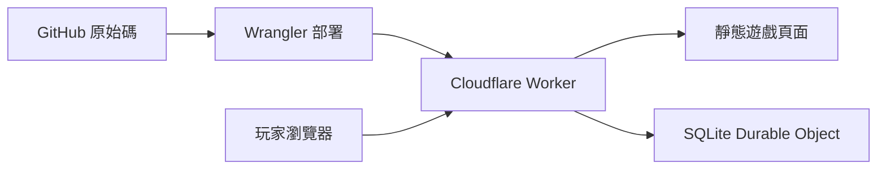

# 移動人生

一款繁體中文職場黑色幽默遊戲。多種職缺、雙心情、隨機人設、升遷與離場，收集 883 種職業結局與 1,000 枚圖文成就。

**[開始遊戲／史冊補完計畫](https://hedo-life.bvstudio.workers.dev)** · **[探索禾多島](https://hedo-life.bvstudio.workers.dev/island/)** · **[GitHub Issues](https://github.com/gn02335338/hedo-life/issues)**

## 這次的人生

- 親屬線玩家實測（v68）：不受歡迎的「自己人發話」仍會留下出場與好感損失，但不再被當成友善熟悉度，避免得罪人後反而更好約飯。正向合作照常累積交情，高薪、補助與成功時的省力收益保留。續玩舊版親屬人生時，遊戲主畫面會說明需要重新應徵才能使用新版待遇。

- 自己人待遇（v67）：乾兒子／乾女兒正式任用後，月薪至少 180K，依原薪資提高至 2.2 倍或加 60K，最高 500K；任用時另給 24 存款指數，每完成兩個工作回合再給 6 點生活津貼，存款上限仍為 100。一般員工的學歷刁難、降薪談話改成特殊任用、待遇保密與同儕競爭事件。「擺架子」在工作場合有實際省力與心情收益，也可能得罪同事；瑞克、公主仍有競爭，私人聚會不保證吃這套。從重新應徵開始生效，舊局保留原規則。

- 分享前補完（v66）：每局都能獨立留名、改名與撤榜；同一玩家的新低分也會保留，榜面顯示前 50 局。成就擴至 1,000 枚，以每頁 36 枚、分類與解鎖篩選瀏覽，鎖定內容仍保密。角色故事以目前新人生實際可抽的獨立事件盤點，不計同事件的三個選項或後續幕數；28 位公開角色與公司神秘人物各至少 31 段，報表可用 `node scripts/audit-cast-v66.mjs` 重跑。首屏新增骰履歷入口，報到時拒絕任用也有獨立的收尾說明。

- 新增 201、順哥、海姐、丁哥、詹姆士與強尼六位角色，搭配同風格動畫頭像與 48 段日常事件。圖鑑保留簡短介紹，工作、飯局、好感、回嘴及夢境／現實衝突各自留下紀錄。減肥活動改由傑克主揪，分強尼隊、安妮余隊、阿福隊，仍可安排七天飲食與活動。福委會另有丁哥主持的真人駱駝大賽：先排名次預測，六輪擲骰揭曉骰色與步數，同格疊堆會一起移動，結束後結算活動點。順哥的區塊鏈支線從找資源、做報告與專利送件，走到翅膀只給少量經費和舊設備、要求現有工程師兼任，再宣告收攤。新事件從新開的人生生效，舊局保留原本規則。

- 新人生的事件都能明確選擇離開當下場合：飯局、點心、多幕活動、互動小遊戲與股東會可中途退場，一般工作擅離會消耗當天，PIP 缺席也會留下紀錄。台詞與結果依場合分開寫，已付款項、已成立的任用與公司通知都不會因此撤回；已揭曉的結果先看完，不能用離場重抽。中止參與不算完成活動。Roadshow 改為全公司到場、水蛇控場，對照翅膀和屎潘蛇講不清楚的承諾與林老師有條理的說明；台下仍有六題互動。來賓咖啡喝到飽，水蛇卻以場地方單杯 300 元提醒員工別喝，傑克則一路偷補杯，散場還外帶。

- 心情或體力任一降到 30 以下，事情告一段落後就會出現休息空檔；活動、人事談話仍會先完整結束。心情歸零保留真正失控的後續。認股多了存款全押、信貸加碼的選擇，借款分期會隨實際工作扣款，未清償餘額也會留在結算。公主的飯局改為高價餐廳，邀約與下單前都顯示 52 存款的餐費，拒約或取消不扣餐費。這些規則從新開的人生生效，舊局保留原本結果。

- 新增三段辦公室點心插曲：傑克請飲料可選品項或不喝，強哥固定要滿料大杯；船長安排公司下午茶，從一點五星店家走到取餐風波；三位同月壽星合照後，傑克面對沒退冰的高級冰淇淋蛋糕。每段有三幕、腦洞與回嘴選項，參與後才揭曉實際變化。公司下午茶若被取消，這局不再重發，私人請客仍保留。插曲只在適合的工作時機隨機出現，不加入活動選單，也不額外推進工作日、薪資或 PIP。另有九枚圖文成就，未解鎖前保密；新內容從新開的人生體驗。

- 隨機職業的十二種普通職缺會抽完一袋再洗牌，重擲與重新應徵共用同一袋，減少短時間反覆出現相同職業；高階主管維持稀有，也可能拿到「特別任用職缺」。後者到報到時才知道是乾兒子或乾女兒，接受後沿用特殊任用的薪資、升遷限制與自己人發話，另有瑞克、公主各一場入職介紹。介紹不多算工作日、薪資或 PIP 倒數。舊局仍依原有規則進行。
- 新增 32 枚圖文成就，涵蓋認股、股東大會攻防、七種活動的實際操作、球場傷退，以及特殊任用與角色互動。每枚由已發生的選擇和結果驗證；未解鎖的名稱、圖案與條件仍保密。

- 新人生可能先收到員工認股邀約：翅膀拿「大企業都入股」催你把握機會，認購會投入 35 或 50 存款指數，股份尚未變現。之後收到股東會通知，真真可能以座位不足、代投票勸退；堅持親自出席，才會與傑克一起進場。大會有四輪原創證詞攻防，可逐句追問、查閱文件、挑一句提出證據，也能先保留問題。翅膀、屎潘蛇、法師、真真、Janet 與阿福各自接招；文件用錯會失去發言可信度，答對則留下可核對的紀錄。結果選後揭曉，散會回原本工作，不因這場勝負自動離職，也不多扣一個工作日或 PIP 回合。舊局保留原規則。
- 結局可選擇用暱稱留名上榜，也可以只看分數、不公開。排行榜分綜合分數與單項成績，能依離場時的實際職業篩選；每局都能獨立留名入榜，同一位玩家可以保留多局；未留名的紀錄不會自動出現。
- 七種活動加入可操作的小遊戲：腕力連點／穩定八拍、七天飲食運動規劃、Roadshow 訪客分流、共享菜預算、First Love 節奏、籃球五波攻防，以及審查佐證配對。交出操作後才揭曉成績、劇情與數值；限時項目另有不拼手速的模式。阿福與歐文也會上球場，硬切會提高碰撞機會；有瘀青後留在場邊收隊，完整結束活動再休息。新玩法從新開的人生體驗，舊局保留原本流程。
- 惡言相向先使用當場角色的專屬台詞，沒有專屬稿時直接回應眼前的說法，不再因正文順口提到「會議」「設計」「客戶」就跳到另一個主題。林老師、聚餐與同事活動等 55 個事件另有修訂；選前台詞、結果、背鍋紀錄與離場說明保持一致，原存檔與亂數不改寫。
- 腕力、減肥、Roadshow、公司聚餐、尾牙、下班打球與政府專案審查，都會明確標示開始、進行中、本幕結果和結束。最後一幕的結果確定後，才會顯示活動結束；回到原事件也會提醒接著處理什麼，不會又開一場活動。

- 「受不了了，扁他」放在最後一個劇情選項下方。單人對話直接針對眼前的人；多人明確同場時，先從在場者的頭像與別稱中選一位，也可以取消，例如三件套共同談話可選法師、真真或阿福。挑人不推進時間、不抽結果；確認後才揭曉是腦內幻想，還是真的失控。報到、PIP、降薪與尾牙各有反應。幻想結束回原場景，真動手則進入獨立後續。每工作回合只結算一次，已確定的結局不能反悔。
- 每組劇情選項下方另有「惡言相向」，排在扁他之前。按鈕會先顯示這個場合要說的話；多人同場可先看各人的台詞，再選對象，沒有對話者時則對空氣開罵。回覆跟著報到、PIP、薪資、職業工作、尾牙與眼前的事件改變，選前只見台詞，後果仍保密。後續可能被忽略、翻臉、遭反嗆、有人聲援，或轉成人事與法律爭議，依角色、心情、場合與 PIP 經歷抽取；結果與實際變化選完才揭曉。每工作回合只能開嗆一次，選人或取消不耗時間、不抽結果。
- 開嗆只記互動與被罵角色的好感，不計為幻想或實際扁人。法律分支可以釐清原話、為失言道歉，或花 12 存款請律師協助回覆，再面對撤回、和解或待處理的結果；遊戲不預判真實法律責任。人事後果可能是書面警告，PIP 後或翅膀暴怒時則可能直接收到離場通知，沒有額外送一輪改善機會。
- 1,000 枚成就附有原創插畫、名稱、故事與取得日期，涵蓋各職業、八階職涯、學歷、PIP、降薪、花錢自救、能力取捨、暴走與尾牙。未解鎖的名稱、圖案與條件保密；成就先留在本機，再由伺服器重播驗證後同步，不必等到離場。舊局也能依已發生的紀錄補領符合條件的新成就。
- 扁人成就依同一次事件的結果區分「腦內夢境」與「現實出手」。對某人真的動手、報到就真的扁翅膀，以及出手後正式存證，都必須有對應的現實紀錄；夢裡扁人、宣洩與追不到阿良另有自己的章。以前混算的 14 種舊章只保留已收藏的紀念，不計新版進度，也不直接換發實打成就。仍在瀏覽器裡的有效遊戲紀錄若能證明新條件，會另外補領；只有舊章和日期則不推測當年發生的是哪一種。
- 人物圖鑑收錄二十八位公開角色，分開顯示當局互動、已驗證的個人累計與全站合計。想像扁人、真的出手，以及好感增加／減少各自計數；結果揭曉後才更新，不把腦內劇場算成現實。當局好感從 50 起算、介於 0～100，記錄角色互動；新人生的飯局邀約也會參考當局熟悉程度與好感，不影響升遷或工作事件抽選。
- 尾牙在任職中後段隨機登場，依序進場、抽獎、散場。可猜瑞克的紅白穿搭、替傑克與水蛇的 First Love 搶麥決鬥記分、聽飯桌上的 NASDAQ、敲空餐盤、抽獎請飲料，再決定如何結束這個晚上。男性角色可邀阿良暗黑續攤，女性角色則改約吃甜點；他都會答應，再自己消失，沒有出發就不扣續攤費。
- 腕力相關日常會標示場邊插曲、等人或影片回放，正式活動第一幕則標示「腕力大賽開始」。裁判太多的插曲改用針對現場的惡言，結果與背鍋紀錄也顯示同一段話；不改既有存檔、亂數或數值。
- 腕力賽保留阿福反覆找理由的橋段：喊抽筋、拉到、吃太飽，卻吃了三片披薩；傑克讓到只比十秒、未分勝負算阿福贏且不錄影，他才上桌。玩家可以計時記錄、替他開披薩盒記者會，或頒發「尚未出賽世界冠軍」。賽後改口與怪別人弄傷手的對白為遊戲創作。這兩場的顯示文案也會套用到舊局與背鍋紀錄，不改原存檔、抽籤、數值或重播結果。

- 「史冊補完計畫」可在遊戲網頁填寫，不用 GitHub 帳號。可補故事、提建議或回報問題；預覽並確認公開後，由背景流程代開 Issue。私人佇列只暫存原文，成功後刪除站內副本；公開內容留在 GitHub，投稿不會自動加入遊戲。

- 可直接選擇系統工程師、AI 工程師、MIS 工程師、專案經理、產品經理、設計師、商務開發、業務、財務專員、會計專員、人資專員或行政專員；另有「隨機職業」，抽選範圍包含以上十二職業與隱藏的高階主管。履歷會揭曉抽中的職業，重擲時職業也會重抽，仍共用三次重擲額度。
- 八階職涯：助理 → 專業員工 → 資深 → 主任 → 副理 → 經理 → 總監 → C-level。系統工程職涯依序是助理系統工程師、系統工程師、資深系統工程師、主任系統工程師、系統工程副理、系統工程經理、系統工程總監、技術長；其他職業各有對應的完整路線。資深、主任仍是專業職，從副理起才進入管理職；專案經理、產品經理的職稱也不代表已經帶人。一般正式職從專業員工開始，助理先轉正，高階主管從經理級開始，也能選擇卸任。
- 報到分成三種開場：照原職錄取、改派其他職務、改以助理任用。原職開場直接從領名片、聽交辦開始，不預設新人已經擔心被改派；另外兩種會說清楚實際職稱，助理也會核對縮水後的薪資。三種情況各有自己的接受、交涉與離開選項，選後回應也分開寫。
- 履歷會擲出本局角色性別，供劇情分流，不代表或收集玩家本人的性別，也不加減能力或起薪。新增十二場性別分工與瑞克事件，包含偏見提問、咖啡交辦、報告代答及專案家譜；每場都有腦洞回應。
- 任職途中可能出現「應徵乾兒子／乾女兒」，也可在符合條件的升遷選單主動提出。成功後正式職稱與月薪會改變，原專業與職級留在履歷；特殊任用期間暫停一般升遷，仍可談薪、被處分或離場。申請、拒絕與返回不多耗工作日。
- 正式成為乾兒子／乾女兒後，對話多一個「自己人發話」：對同事拿身分壓人，對翅膀、董事長改口表忠。各位角色都有自己的反應，也會看場合、交情與心情抽取後續；有人勉強配合，有人反嗆，也有人直接找上層確認。多人同場可先看各人的台詞、選定對象或取消，結果與好感變化選完才揭曉。每個工作回合只能用一次，說完回到原本的選擇，不會暗中替你簽 PIP、接受降薪或支付餐費。現有已任用存檔也能使用。
- 工作、偷懶、舔功先骰點數，再分配有限的時間與精力；三項總和最多 180。一次選擇若練高其中一項，另外兩項就得退讓，花錢上課也不例外。實際取捨會列在選後明細。學歷、系所與錄取薪資也會抽取；報到後才知道實際工作，高階主管則保留原職迎接自己的挑戰。
- 存下離場的底氣：新人生完成六個工作回合、存款達 75 後，可以規劃離職創業；完成十個工作回合、存款達 90 後，可以退休或只接自己想做的顧問工作。各自達標後會在安全的工作空檔提醒一次，也能從「我想離職了」或職涯離場清單再查看。規劃與返回不花工作回合、不推進 PIP，也不等於已經離職；創業投入 35 或 40 存款，確認後才扣款並揭曉這輪結果。十三職業各有四種創業／退休結局，共 52 種，未解鎖前照樣保密。
- 「翅膀心情」只代表他本人，影響人事、協商與升遷。同事間的衝突主要記在情義與故事後續；對方真的轉達翅膀的反應，才會有限度地改變這一格。腦內扁人不會讓他隔空生氣，對其他角色真動手，這一格也只承受較小的後續影響。每天另外抽取他的脾氣，與你眼前正在跟誰說話分開計算。
- 前期可能被翅膀笑著問學歷，接著拿校名、科系與薪水找碴。工程職科系落差、他不喜歡的背景，以及相對於實際職務偏高的薪水會加重風險；可能由希望要求提前降薪，或由三件套接手離場。仍可協商、拒絕或要求 PIP，同一段學歷爭議只觸發一次。
- 月薪低於 30K 時，法師會在適合談話時私下提醒留存薪資與工時紀錄，並提到諮詢、申訴、調解及訴訟。包含報到起薪就不足 30K，以及之後實際接受降薪兩種情況；每局提醒一次，收到降薪提案但還沒接受不算；三種回應包含讓計算機穿法袍出庭，選完回到原工作，不多耗一天或 PIP 倒數。2026 年全時正常工時的最低月薪為 29,500 元，故事不保證個案或訴訟結果。
- 711 個日常事件、4 個幻想事件，包含職位為「老闆乾兒子」的瑞克、林澤教授、傑克與業務經理水蛇的改編橋段；不用走到最後一關就可能離場。
- 私人同事大問答的 149 題已逐題對照，新增 95 場事件、285 種回應，分散在工作、學歷、調薪、PIP、帳務、聚餐與交接場合。已有橋段延續原場景，相近題材合併，敏感內容則改成匿名職場情境；不公開原始題庫。十五場新增多人談話可以選擇當下的出手對象，提到往事或電話那端的人不會因此出現在房間裡。
- 新增 60 個職業專屬工作事件：業務、商務開發、設計師各 12 個，其餘六職業各 4 個。業務要面對報價、試用、CRM 與獎金；商務開發處理合作條件、通路和漂亮但尚未落地的提案；設計師則要救版位、追原稿、讀懂老闆每天不同的 OK。每個新事件都有腦洞選項，保留史冊裡的設計迴圈、工具預算、功勞歸屬與瑞克等梗。
- 財務、會計、人資、行政各有八場專屬工作事件，共 32 場、96 種回應，每場至少一個腦洞選項。財務算資金與付款，會計核憑證與月結；行政可能兼招募，人資可能兼行政或被叫去泡咖啡。兼任事件保留主要職稱，報到改派則會交代實際職務。四職業各有完整八階職涯與 42 種結局，原有圖鑑順序保留，合計 545 張。
- 新人生會更常抽到目前實際職業的工作，第一個一般工作事件先從該職業專屬故事開始，也避免連著多天只遇到共通工作。若報到時被改派，工作內容跟著實際職業走；人事、PIP、升遷、尾牙與其他插曲仍保留原本節奏。選前不顯示抽籤機率或結果。
- 學歷爭議會依翅膀當下嫌的是科系還是校名，給出對應選項。本科不符時可以報考台大電機、寫信詢問林澤教授是否指導；送出申請不代表已錄取。顧問事件另有辦公室 Wi-Fi、教授介紹與留任、研究問題變上線日期，以及進修也被追進度等原創橋段。
- 研發部經理傑克帶來六個原創事件：會議筆記、交接轉手、API 帳單、替同事說明困難、PIP 自評，以及離場文件與職稱。玩家以同事身分參與故事；傑克也有動畫頭像與專屬暴走成就。
- 業務經理水蛇加入上班對話，也可能在三樓碰見你。角色採別稱與完全原創動畫肖像，另有專屬暴走故事及兩枚成就；新對話從新版人生啟用。
- 扁人的結果揭曉後，腦內夢境會出現淡紫雲霧、月亮與「現實沒有動手」標示，可按「回到現實」繼續。真失控則標示事情真的發生了。背鍋紀錄也會區分；選前不提示會抽到哪一種，舊局的夢境顯示也會潤飾，但不改寫重播資料。
- 未解鎖圖鑑只有問號。選項不顯示數值效果、機率或預告結果；付費安排會先標明花費，選完才揭曉實際增減、運氣結果與明細，背鍋紀錄也會保留。
- 離場結算改用視覺化報表：能力雷達與長條對照起點、離場，折線呈現心情、體力和存款指數的變化，另列翅膀心情、同事情義與大餅信仰。每個轉折代表一次已結算選擇，同一天的休息、人事與飯局不會被當成額外工作日。缺少紀錄的起點標為未知；報表只讀既有數值，舊結局也能顯示，不改寫存檔或額外上傳資料。
- 每個日常、幻想、人事與職涯場景都有至少一個腦洞選項：替報告貼輪迴靈符、請影印機進 PIP、為薪資單辦回顧展。選後回應也跟著改寫；荒謬的做法仍受原本的能力、資源與隨機規則影響。
- 心情與體力的起伏更明顯：一般劇情的消耗與恢復放大，每天也可能特別耗人或意外順風。PIP、疲勞與降薪會加重壓力；PIP 不會自動補高翅膀心情。尚未確定離場時，心情歸零會在已選結果之後進入真正的當場崩潰，以深紅框與現實標示區別腦內夢境。可以花錢離開現場休整、請無薪假承擔後續月薪減少，或當場念完離職信；沒有強迫角色真的動手。
- 新人生的心情歸零分四階，每階有自己的對白。第二次起，休整越貴、恢復越少，無薪假的薪資與人際代價也會加重；第五次起沿用第四階。畫面只標已經歷的次數與本次費用，選後才揭曉變化。歸零時，最後一個按鈕改成「受不了了，自爆」，可以把壓著的話公開說出來，再選休整、請假或離場。這條是職場情緒失控，不計為真的或夢裡扁人。
- 新人生完成眼前事件、看完結果後，心情或體力任一進入警告範圍（剩 1～30），就會出現「工作空檔」，兩項都未進入警告時直接繼續劇情。此時才能從工作證的「存款怎麼花」安排休息，每個工作回合可開一次；休息後即使體力恢復，也會留在同一段空檔，由玩家按「繼續上班」。活動、偶遇與人事談話結束後，心情或體力若在警告範圍，也會補上可用的休息空檔。從正常體力降進警告、還沒得到休息機會時，會保留最後 1 點體力撐完這段流程，實際緩衝會列在選後明細；已有休息機會卻繼續硬撐，仍可能耗盡。對話及活動途中不能插入休息；人事通知仍優先處理。休息、吃飯或取消安排都會回到同一段空檔，不多算一天，也不推進 PIP。舊存檔保留原本的休息時機。七種付費安排包括飲料散步、補眠、實作課、備份證據、人脈聚餐、週末休整，以及請玩具鵝擔任主管的練團室會議，分別照顧心情、體力、能力、紀錄或人脈。買不起的選項不會出現，也能選擇先不花。消費不額外推進工作日或 PIP，存款耗盡仍會離場，記得留生活費。
- 找人吃飯可從二十八位角色中挑一位，每人有不同的餐桌對話、回應與費用，並保留腦洞選項。新人生先傳邀約、等對方答覆：不熟、高層或跨部門主管容易拒絕；這局的交情與同部門經歷能提高赴約機會，仍不保證成功。同一工作回合不能反覆邀同一人重抽，被拒絕不收費，仍能改約別人或取消後自己休息。e37 新人生的名單分三頁，舊局保留兩頁。選人、翻頁或取消不花錢，正式用餐才扣款並結算心情、能力與好感。飯局不多耗工作日或 PIP，低心情的吃飯邀約也使用同一份名單。餐費先列明，付不起仍看得到停用選項；與翅膀吃飯未必能放鬆，阿良的續攤則可能又只剩承諾。
- 男性角色可能在上班途中被技術經理阿良突然揪團，按紓壓也可能遇到他的私房邀約。女性角色不會收到暗黑邀約，仍可正常約他吃飯。跟去要花一大筆存款，換回心情與偷懶能力；嫌髒可以拒絕，突然被揪時拒絕就直接回工作，仍可另外安排休息。這條支線採原創虛構設定。
- 離職人物介紹再改編 44 個原創事件：接手前人的工作、挽留與反悔、臨時兼職、薪資單位、交接文件、職務合併與前同事互助。角色採匿名合成設定，私人人物介紹及原始材料不公開。
- 升遷會調整薪資，也會增加日常責任與管理抉擇。新局要先累積目前職級的實際工作經歷，高階評核更挑剔。可以用成果或討好爭取、先補強能力，或婉拒升遷；不必靠帶人才能有自己的好結局。職級路線與觀測站分布不公開未解鎖結局的名稱。
- PIP 通過不代表人事衝突解除：選擇留下後，可能被安排到三樓看門，辦公室與原本的工作仍在五樓。值班期間有獨立日常與後續選擇，保留收入也要承受沒有工作可做的壓力。通過後若再因新的對話惹怒翅膀，他的耐心會比先前低；持續低心情本身不會每回合重複觸發處分。
- 翅膀大怒時也可能不給 PIP，直接由三件套通知離場。這條流程不再藏著一個「要求 PIP 就能留下」的選項；可以核對文件離場，或整理紀錄向勞工局反映、進入遊戲中的勞資調解。故事不保證申訴或協商結果。
- 圖片史冊擴充加入 30 個原創事件，包括群組留言抽籤與 PIP 期間的續命蘑菇；影音史冊再加入 10 個同事活動與職場反應事件。原始截圖、影片和音軌留在私人研究資料夾。
- 文案依 Humanizer-zh 審讀，保留技術梗和職場黑色幽默，修整不通順或重複的句子。新版事件與文字從新局啟用，舊局維持原本的重播結果。
- 工作證新增「準備升遷」：想訓練或談下一階時可以主動開啟。未達申請條件時不再定期強制叫去評核；婉拒後會多留幾天工作。升遷仍受原本的任期、能力和高階評核限制。
- 新局另有「我要談加薪」，與升遷分開。完成三個工作回合後，可以帶成果談薪、先整理翅膀的方向，或拿玉璽印泥墊請他御批；結果可能是書面方案、口頭拖延，或把薪資問題談成忠誠度考試。真正接受書面條件才會改月薪，職級不會跟著升；若方案拿其他給付抵銷，還能看清楚後拒絕。正式談過後須再工作五回合，每局最多三次，收回資料、不正式開口則不占次數。談話本身不多算工作日、任期或 PIP 倒數。
- 手機每次繼續會直接到新故事，故事上方可看心情、體力、存款和 PIP 倒數，再一鍵往返完整工作證。
- 體力或心情剩 30 以下時，故事與結果頁會顯示預警；15 以下改為紅色危急提醒。可休息時能直接查看休息安排，暫時無法休息時會說明原因。提醒只讀目前數值，不預測選項結果，也不改變遊戲判定。
- 新人生的消費入口只在休息空檔出現；升遷與加薪入口停用時，會直接寫出原因，手機也不必靠滑鼠提示。查看事件結果、報到與人事通知期間，先完成眼前流程；心情或體力進入警告並出現工作空檔後可以休息；升遷與加薪仍依任期、PIP 與等待時間判斷是否開放。休息每個工作回合只能開啟一次，選「先不花錢」也算使用這次安排，選單會先提醒。
- 遊戲內可開啟「數值與運氣怎麼算」，查看九項數值與隨機機制的用途。
- 翅膀、屎潘蛇、瑞克、希望、法師、真真、阿福、阿良、傑克、水蛇、海倫（前女友）與林老師各有原創動畫角色；三件套同場時並列三人頭像。另有粉紅白色介面、手機版、可切換音效與可下載的離場證明。

新增 20 個史冊改編事件：端午猜謎靈感 8 個、阿福日常 6 個、海倫故事 6 個。阿福也叫桑尼；海倫以「前女友」別稱加入，職位為產品開發總監，故事涵蓋開門、SQL、交接延期、離場後的需求與群組權限。綽號採辦公室比喻，不當作真實交往紀錄。角色有原創動畫頭像、專屬夢境／現實失控反應，互動與好感可在角色圖鑑查看。新內容由 `e22-` 新人生啟用，現有存檔保留原結果與亂數序列。

選職頁新增「翅膀欽點・徵才標語」：要好命就不要來移動，要計較就趁早離開這裡。報到桌前的「報到須知」會再呼應一次。標語只更新畫面，不提前透露選項結果，也不影響心情、亂數或工作安排。

五位同事加入角色圖鑑，每人有原創動畫頭像、四段日常與自己的夢境／實際失控反應：稽核主管紅茶、助理工程師強哥、商務開發總監歐文、資深資料探勘工程師山姆、資深專案管理師辛蒂。故事包括刪不掉的印表機、助理工程師的責任邊界、重複跟進與離職倒數、洋芋片讀書會與沒約成的離職飯，以及主管接力與反覆變動的老闆評語。每段保留腦洞選項；紅茶與阿福的關係、辛蒂與主管離場的關聯都保留為辦公室傳聞，不替角色確認原因。新事件由 `e23-` 新人生啟用，舊局沿用原本的故事與亂數。

行政長改以「真真」顯示，角色 ID、頭像、成就與統計沿用；舊對話及背鍋紀錄也會顯示新名字。引擎使用的歷史文字另行保留，不改寫已儲存的人生或重播證據。

角色統一使用別稱；顧問角色以「林澤教授」稱呼。舊局的工作證、對白、背鍋紀錄、圖鑑與離場證明也會顯示新名稱，但不改寫原始存檔或重播資料。

薪資標籤統一為「月薪」，舊紀錄也套用目前顯示用語；原始重播文字維持不變。

目前仍使用預設遊戲選項，尚未串接 Gemini 或開放自填答案；Gemini 串接僅評估可行性，未啟用。史冊投稿表單與遊戲答案分開處理。

遊戲為非官方的虛構諷刺創作。角色台詞、薪資、機率、人事流程與學歷偏見均為遊戲敘事，不代表已查證事實或對學校／科系的評價。學校與系所是遊戲隨機組合，不是招生資料。公開新聞和產品只作場景靈感；私人 Notion 原文、連結與研究摘錄不包含在公開版本中。

## 準備升遷的條件

八階職涯使用以下規則，職稱依實際職業對應；已獲乾兒子／乾女兒特殊任用時，原專業升遷暫停。工作證從 DAY 4 起，可在一般工作事件開啟「準備升遷」；當下不能正在 PIP、查看結果或處理其他通知，職級也必須還能往上。開得了選單，只代表可以準備或訓練，申請還要符合任期、當前數值與評核間隔。

下表中的「任期」只計目前職級完成的日常／幻想工作回合；升遷、助理轉正或卸任後重新累積。評核、訓練、談薪、休息及主管抉擇不增加任期。數值都是最低值，兩條路擇一，且體力必須大於 10、自己的心情大於 12。

| 這次要談的職級 | 最早遊戲日 | 目前職級工作任期 | 實績路線 | 討好路線 |
| --- | --- | --- | --- | --- |
| 助理 → 專業員工 | DAY 4 | 2 回合 | 工作 50、情義 30、翅膀心情 35 | 舔功 55、翅膀心情 55 |
| 專業員工 → 資深 | DAY 5 | 2 回合 | 工作 55、情義 35、翅膀心情 40 | 舔功 60、翅膀心情 60 |
| 資深 → 主任 | DAY 8 | 3 回合 | 工作 62、情義 40、翅膀心情 43 | 舔功 66、翅膀心情 64 |
| 主任 → 副理 | DAY 11 | 3 回合 | 工作 68、情義 45、翅膀心情 48 | 舔功 72、翅膀心情 70 |
| 副理 → 經理 | DAY 14 | 3 回合 | 工作 75、情義 50、翅膀心情 55 | 舔功 80、翅膀心情 78、工作 58、情義 35 |
| 經理 → 總監 | DAY 17 | 3 回合 | 工作 83、情義 60、翅膀心情 63 | 舔功 87、翅膀心情 85、工作 70、情義 45 |
| 總監 → C-level | DAY 21 | 4 回合 | 工作 90、情義 70、翅膀心情 72 | 舔功 94、翅膀心情 92、工作 80、情義 55 |

助理到主任在上次評核後至少隔兩個工作日，副理以上至少隔三個；選擇「這次先不升」則延後六個工作日。訓練和失敗也算一次評核，不能靠反覆開關選單重骰。條件齊了仍要通過隨機評核，越高階越挑剔；沒有任何一條路保證成功。自動邀請也會等到至少有一條申請路線可用才出現。

## 匿名收藏與人生觀測站

「這份工作，怎麼結束的？」依遊戲收尾路線統計如何離職，顯示局數與占全站完成局數的比例。自行離職、被要求簽自願離職、公司要求離場、PIP 未通過或通過後離職、冷凍調職、勞資爭議、身心或存款耗盡、創業與退休分開列出；尚未明確離職的收尾另外計數，不公開結局名稱。每局只歸一類，既有完成紀錄也會納入；未知的歷史結局保留為待分類，不需要重玩或額外採集個人資料。

不必註冊。瀏覽器產生隨機匿名憑證，伺服器保存其雜湊與玩家 ID。已完成遊戲由伺服器重播驗證，同一局重送不會重複計數。斷線時仍可玩，待同步紀錄會自動重試。

觀測站顯示匿名玩家數、完成人生數、結局覆蓋數與每日完成趨勢，另以圖表比較應徵與實際職務、改派比例、結局類型、任職長短及月薪區間。新版八階職級、舊五階與乾兒子／乾女兒特殊任用分開統計；PIP、升遷、降薪及崩潰也有發生率。新增指標列明採集起點與有效局數，尚無制度資料的舊紀錄保留為未分類，不用同一個 rank 數字猜職位。匿名玩家數不等於真實人數；統計是休閒用途，不是競賽排名。每日統計使用 UTC。成就保存於同一匿名身分，只記成就 ID 與首次解鎖時間；進行中的成就同步不增加完成人生數。

人物統計另記完成互動次數、想像／真出手次數，以及實際好感增減量與發生次數。翅膀的好感只採用已揭曉選擇造成的變化，排除每日脾氣與臨場運氣；其他角色依當下互動記錄，不把整個團隊的情義分數當成個人好感。三件套的普通共同談話會分別記一次互動；暴走只記實際選中的那位，其餘兩人不跟著增加被扁次數。這些數字不代表真實人物的感受。

人物統計從功能上線起開始驗證收錄。進行中的同一局以延續原分支的紀錄補上增量，重送不會重複計數；已完成的舊局若沒有當時的角色驗證紀錄，不會猜測回補。原有結局與成就仍保留。離線時的當局預覽與已驗證累計分開顯示，未載入的全站資料不會冒充即時數字。

進度存在目前瀏覽器；清除瀏覽器資料會失去匿名身分。不同裝置是不同玩家。頁尾「匿名紀錄」可匯出／匯入圖鑑，帶走已收藏故事；備份不包含登入憑證，匯入收藏不會增加全站統計。舊版 v1/v2 同網址的收藏會保留，進行中的 v1/v2 舊局因規則不同不會轉換。v3 的既有局則沿用原規則；e21 新局保留八階職涯、能力取捨、心情體力波動、崩潰、消費、獨立談薪與 e20 人事流程，再加入職業專屬工作與新的工作抽選安排。e20 與更早局保留原本的事件池、歷史、亂數序列與重播結果；e19 與更早局不插入 e20 人事事件或水蛇對話，e18 與更早局也不插入談薪。

遊戲紀錄不要求姓名、Email 或真實學歷，不保存原始 IP、選擇內容或亂數種子。驗證時會暫時重播操作紀錄；伺服器保存人生與玩家的綁定、種子及操作序列的雜湊、已驗證操作數與角色累計，不留操作原文或對話。個人角色累計須用本機匿名憑證讀取，全站只公開合計。匯出的圖鑑含本機成就、不含匿名憑證；匯入只算本機收藏，不會變成伺服器已驗證紀錄。主動投稿另存私人佇列，防濫用使用短期連線雜湊；公開 Issue 不附匿名玩家 ID。詳細欄位、保留期限與限制見 [Worker 說明](worker/README.md)。

## 本機開發

需要 Node.js 22 與 npm。

```sh
npm ci
npm start
```

開啟 `http://127.0.0.1:4173`。本機使用獨立的 Workers／SQLite 儲存，不會修改正式資料。前端位於 `dist/`，無額外編譯流程；字型載入失敗時使用系統字型。

```sh
npm test
npm run build:check
```

測試涵蓋八階升遷、助理轉正、高階主管與卸任、專業與管理責任、三種報到選項、故事支線、隨機人設、職務改派、PIP／直接離場、三樓待命、勞資爭議故事、心情消耗、紓壓與消費限制、結果明細、薪資、新舊規則重播、自然結局路線、API 驗證與離線重試。`research/reachability-v3.json` 是可重播路線證據，包含劇透；一般遊玩不需要閱讀。重新搜尋全部 883 種結局的路線可執行 `node tests/find-routes-v3.mjs 5000`。

目前新人生另以 `tests/fixtures/current-endings-v66.json` 驗證全部 883 種結局：每條都從正常的 `r66` 種子、活動行事曆和公開操作開始，經過與網頁相同的薪資／邀約接續，再以伺服器重播規則核對。這是刻意朝目標遊玩的可達性證據，不代表隨便選都容易抽到，也不以舊版能達成代替新版驗證。重找可執行 `node scripts/find-current-endings-v66.mjs --attempts=5000 --output=artifacts/current-endings-v66.json --fixture=tests/fixtures/current-endings-v66.json`；不完整結果不會覆寫正式證據。人物數量盤點另見 `research/cast-event-counts-v66.json`，新成就的自然操作證據見 `tests/fixtures/achievement-milestones-v66.json`。這些檔案都含劇透，遊戲中仍保持問號。

體力警告修正另以十三職業、三種固定策略跑 1,170 局，包含 3,053 次警告休息機會、174 次 PIP 休息與 8,221 幕活動。這輪沒有漏掉可用空檔、首次休息機會前體力歸零、活動／人事談話中插入休息，或休息誤扣 PIP 的情況。存款不足以補眠，或只買飲料後繼續硬撐，仍可能耗盡。這是可重播的模擬，不代表實際玩家比例。可用 `node scripts/energy-pacing-audit-v54.mjs 30 e39-cal46-kin49-g-e-s- revised` 重跑；報表留在忽略提交的 `artifacts/`。

e9 平衡調整另跑 72,000 局前後對照與 18,000 局熟手策略，涵蓋九種職業的升遷、降薪、PIP 與離場分布。[實測方法、數據與重跑指令](research/balance-v9.md)。這是模擬情境，不是實際玩家比例。

e10 另完成桌面／手機介面試玩、5,400 局節奏情境檢查，以及新舊重播驗證。[修正內容與驗證範圍](research/playtest-v10.md)。手機採瀏覽器尺寸模擬，情境數據不等於實際玩家比例。

e11 加入前期學歷與薪資爭議，完成 2,700 局自然情境檢查；106 項測試、234 條新版結局路線及全部既有 e10 路線重播通過。[事件規則與驗證](research/education-v11.md)。

e12 為 205 個日常、4 個幻想與 25 個人事／職涯選單逐一改寫腦洞選項，共 234 個場景。111 項測試與全部結局路線通過，舊局保留原文與原重播結果。[文案範圍與驗證](research/wild-v12.md)。

e13 加入隨時開啟的卡通暴走、三段尾牙與 32 枚圖文成就。新機制由新局啟用，e12 與更早存檔保留原結果；已有的可重播遊戲也能補領符合條件的成就。測試涵蓋舊版 234 條路線的 10,172 個檢查點，以及新版全部 234 種結局。新功能 API 可用 `API_BASE=http://127.0.0.1:4177 node scripts/v13-smoke.mjs` 驗證，只允許本機測試資料。[機制與實測紀錄](research/features-v13.md)。

e14 把暴走改為直接針對當下說話的人，按鈕接在最後一個劇情選項下面。幻想與真失控由種子、情緒及對象判定，選後才揭曉；真失控另有六類、54 個職業結局與六枚新成就。既有 e13 存檔仍沿用原流程。181 項測試及全部 288 條新路線通過；另保留 e13 的 243 條結局／功能路線、10,649 個直接與存檔檢查點。新 API 可用 `API_BASE=http://127.0.0.1:4177 node scripts/v14-smoke.mjs` 在本機驗證。[機制與實測紀錄](research/features-v14.md)。

e15 修正科系與校名抱怨的選項對應、加入四個顧問支線，並重寫八位角色的夢境文案與結果介面。191 項測試及全部 288 條新版結局路線通過；292 條 e14 結局／功能路線的 10,931 個檢查點，也逐一比對直接與 JSON 存檔重播。教育選項與新事件從新局啟用；舊局保留原選擇，夢境外觀及顯示用潤飾可直接套用。[機制與實測紀錄](research/features-v15.md)。

e16 將應徵職業改稱「高階主管」，統一角色別稱，並加入研發部經理傑克的六個事件、動畫頭像與暴走成就。新局共有 215 個日常事件、4 個幻想事件、288 種結局與 39 枚成就。傑克事件從新局啟用；既有 e15 與更早局的事件池、機率、亂數序列和重播結果維持原樣，別名只更新顯示。

同時補回新局漏套的升遷限制：任期、訓練增益、高階評核與自動邀請沿用 e12 的平衡規則，前期學歷降薪也會使用對應文案。205 項測試、全部 288 條新版結局路線，以及 e15 的 292 條路線、10,470 個直接與 JSON 存檔檢查點通過；另以本機 HTTP 驗證傑克的暴走成就、失控結局、匿名隔離與重送去重。

e17 將新局職涯展開為八階，補上資深與主任的專業工作、評核及離場故事；新增 8 個助理、9 個資深與 9 個主任結局，總計 314 種。原有 288 個結局 ID 保留，仍可從原本的離場路徑取得。日常事件仍為 215 個、幻想事件 4 個、成就 39 枚。報到的三種情況改用不同敘述、選項與結果；角色抽選方式不變，高階主管仍藏在隨機職業裡。

e17 發布時的新局使用 `e17-` 種子。新版的 rank 0–7 依序是助理、專業員工、資深、主任、副理、經理、總監、C-level；高階主管起始為 rank 5。既有 e16 與更早存檔保留五階職涯與原始重播結果，不直接換算成八階。匿名身分、存檔版本及伺服器重播驗證方式不變，資料庫無須遷移。

e18 的新局改用 `e18-` 種子，沿用八階職涯、215 個日常事件、4 個幻想事件與 314 種結局，成就擴充為 112 枚。這次將三項能力改為總和最多 180 的消長規則，放大心情與體力波動，加入歸零後的現實崩潰、七種存款用途，並把翅膀心情與其他人物的反應分開。e17 與更早局不套用這些新數值規則，符合條件的舊紀錄仍可補領新增成就；匿名身分、遊戲版本 3 與資料庫格式不變。

e18 已通過 247 項測試、部署建置與本機 HTTP 驗證。全部 314 種結局都有新版重播證據；[成就路線](tests/fixtures/achievement-routes-v18.json) 以 21 條新版自然操作涵蓋 112 枚成就。e17 的 318 條結局／暴走路線與 13,197 個檢查點也保留比對。另用九職業、相同初始種子各跑定期照顧與不消費兩組，共 900 局：平均工作回合約 20.11 與 9.01，發生崩潰的局數為 68／450 與 290／450；這是測試策略比較，不代表所有玩家的固定機率。

e19 新局使用 `e19-` 種子，加入獨立談薪與書面確認，沿用 112 枚成就、314 種結局及八階職涯。提出方案不會先加薪，接受確認後才更新月薪與日後職級薪資的計算基準；口頭承諾、拒絕或爆氣不會直接加薪。談薪過程可被暴走或心情歸零打斷，恢復後接回原本的對話。角色、台詞與條件採原創虛構設定；沒有加入私人史冊原文或來源連結。匿名身分、遊戲版本 3 與資料表不變，無須遷移資料庫。

e19 已通過 263 項測試與部署建置；[29 條自然談薪路線](tests/fixtures/raise-routes-v19.json) 涵蓋九種職業、口頭承諾、書面調薪、抵銷方案、冷卻與上限，以及暴走、崩潰和人事流程。全部 314 種結局已重新搜尋；e18 的 318 條結局／暴走路線及 14,261 個檢查點保留逐步比對，舊局不改寫。

e20 新局使用 `e20-` 種子，加入通過 PIP 後的三樓看門安排、後續低耐心，以及不提供 PIP 的直接離場與勞資爭議故事。三樓值班照樣計工作日，通知、協商與調解對話則不額外消耗工作回合；選項仍在選後才揭曉結果。業務經理水蛇以原創動畫角色加入，也有兩枚專屬成就。新目錄共有 223 個日常事件、4 個幻想事件、341 種結局與 114 枚成就。

既有 e19 及更早存檔不套用 e20 人事判定、新事件或額外亂數。新版仍使用原有匿名身分、本機儲存鍵、遊戲版本 3 與伺服器重播驗證，資料庫無須遷移；不新增玩家個資或自由文字蒐集。

e21 新局使用 `e21-` 種子，新增 60 個職業專屬工作事件，日常目錄增至 283 個，另保留 4 個幻想事件、341 種結局與 114 枚成就。工作抽選以實際職業為準，第一個一般工作事件為該職業專屬；後續提高專屬與跨職相關工作的出場頻率，也避免連續共通工作沖淡職業特色。每個新增事件都有至少一個腦洞選項，對白、情境與結果皆為原創遊戲改編。e20 及更早局不套用新事件、抽選順序或額外亂數，匿名身分、儲存格式與資料庫維持原樣。

另以業務、商務開發、設計師各三種選擇策略跑 900 局節奏檢查，11,806 個已完成的一般工作事件沒有重複；239 次 PIP 評核前均有三個完整工作回合，未出現 C-level。這是固定策略的模擬結果，不代表實際玩家比例。可用 `node scripts/pacing-audit-v21.mjs 100` 重跑，報表會寫到忽略提交的 `artifacts/player-qa-v21/`。開啟休息、升遷等選單後返回同一件未完成工作，會另外計數，不算工作事件重抽。

e22 使用 `e22-` 新種子，新增 20 段猜謎、阿福與海倫事件，角色增至十一位。所有 341 種結局及 20 段新事件均有自然回放證據；舊 e21 的 341 條路線、14,541 個存檔邊界保持一致。[新增事件、相容方式與原創頭像製作紀錄](research/features-v22.md)。

e23 以 `e23-` 新種子增加五位角色與 20 段事件。36 組自然操作證據涵蓋全部新事件、五人的夢境／實際失控，以及三場多人談話的指定對象；舊 e22 的 341 條路線、14,329 個存檔邊界逐一比對。新增角色沿用既有統計表，不重建匿名身分或累計數據。舊十人／十一人快取仍能讀取，尚未取得的新角色資料以「—」顯示。

e24 以 `e24-` 新種子加入法師的降薪提醒，涵蓋正式接受降薪、無薪假與卸任造成的薪資減少。13 組自然操作證據核對提案、30K 邊界、提醒回應及夢境／實際失控；舊 e23 的 341 條路線、14,474 個存檔邊界保持一致。提醒會等急迫人事、崩潰或其他對話結束再出現；若尚未開口就恢復至 30K 以上，則取消提醒。沿用原有匿名身分與資料表，無須資料庫遷移。

e25 使用 `e25-` 新種子，加入四階崩潰、情緒自爆及十六人飯局。71 組自然操作證據涵蓋四階、自爆後續、全部飯局的兩種用餐回應及低心情入口；舊 e24 的 341 條路線、14,208 個存檔邊界保留逐步比對。開名單不算付費休息，實際用餐才計入相關成就。另修正反覆無薪假降到 20K 以下後，普通降薪提案反而調高薪水的問題；僅新局套用。匿名身分、原有統計、存檔版本與資料庫不變。

e26 使用 `e26-` 新種子，加入同事大問答改編的 95 場事件，日常總數增至 418，另保留 4 個幻想事件、341 種結局與 118 枚成就。[294 條自然路線](tests/fixtures/quiz-routes-v26.json) 涵蓋每個新選項與九種實際職業，每條都附上可完成的後續；十五場多人對話的 33 位合法目標也逐一驗證事件前與結果後的操作。舊 e25 的 341 局、14,114 個完整存檔邊界保持一致，匿名身分、人物累計、成就及資料庫不變。[改編與驗證紀錄](research/features-v26.md)。

e27 使用 `e27-` 新種子，加入存款門檻的離職規劃與 36 種各職業創業／退休結局，總數增至 377。初版保留 418 個日常事件、4 個幻想事件與 118 枚成就。提醒會等人事、PIP、崩潰及其他安排結束，僅在適合的工作空檔出現；退休由玩家確認，創業結果在投入後才揭曉。舊 e26 的 341 局、14,502 個完整存檔邊界保持一致，既有玩家身分、收藏、統計與資料表不變。[規則與驗證紀錄](research/features-v27.md)。

扁人成就另有 [26 條自然操作證據](tests/fixtures/rage-achievement-routes.json)，涵蓋十位角色的真實／夢境、報到時機、存證與失控後續。判定只讀已發生的歷史，不更動存檔、亂數或故事路線；既有 21 條 e18 成就路線也保留原操作，按新條件核對獎章，再以 [四條橋段操作證據](tests/fixtures/chronicle-achievement-routes.json) 核對 First Love 搶麥決鬥的兩種抽籤結果、阿福的理由伯記者會，以及尚未出賽世界冠軍，合計涵蓋原有 118 枚。三枚新章依已結算的選擇解鎖，不看顯示文案或待選選項；未解鎖前，名稱、圖案與條件同樣保密。這兩個橋段不屬於真的動手，不會因此取得扁人成就。

創業／退休另有四枚原創圖文成就，讓總數增至 122：創業成功與失敗分開記錄；玩具鵝董事長依永久休假案解鎖，量產玩具鵝不算；完全退休可取得爽爽退休章，偶爾接顧問案則保留自己的結局。判定只讀已結算的選擇與實際支出，不靠預告、旗標或結局名稱猜測。[自然操作路線](tests/fixtures/wealth-routes-v27.json) 涵蓋兩種創業方式與退休分支，桌機／手機介面及伺服器重播一併核對。未解鎖前，名稱、插畫與條件繼續保密。保留完整 e27 操作紀錄的舊局也能補領，不必重開。

人物統計是獨立的歷史投影，不增加遊戲規則版本或消耗亂數，也不改寫舊局。伺服器另建角色統計表，保存已驗證分支的雜湊與個人／全站計數；原有結局、成就、匿名身分及遊戲存檔格式不變。新增資料表由 Worker 啟動時建立，不需重建既有資料庫。

多人對話的挑人功能適用於 e14 及之後的既有局，不必另開新種子。原本沒有指定對象的操作仍沿用舊預設與重播結果；新操作只能選當時在場的人。取消選人不會留下遊戲操作，也不能藉此重抽結果。已同步的同一人生不能改選另一位來替換原分支。

真實本機 API smoke 的啟動指令見 [Worker 說明](worker/README.md#local-verification)。Smoke 只允許 localhost，避免測試資料污染正式統計。

### 禾多島

`/island/` 是獨立的原創 3D 微縮島嶼體驗，包含九個地點、27 種地點回話、六站「島上的一天」導覽，以及日夜切換與探索護照。點「開始散步」後，用 W A S D、方向鍵或手機方向盤走過小橋；靠近入口或九位同事，按 E、空白鍵或互動按鈕展開故事。九段同事偶遇另有 27 種回話，反應都在選擇後才揭曉；對話與開啟清單時停止走動，Home 或「看全島」返回地圖。本機啟動後開啟 [禾多島](http://127.0.0.1:4173/island/)。無法顯示 WebGL 時仍可使用地點清單閱讀故事與集章。

地點足跡與已選地點回話只存在這個瀏覽器的 `hedo-island-v1`，鍵名與版本 1 格式不變。同事偶遇依公開角色 ID 記在獨立的頁面記憶體中，重新整理後清空，不寫入地點選擇或任何儲存鍵。不呼叫遊戲 API，也不改動職涯存檔、匿名身分或收藏。場景使用本機附帶的 Three.js 0.180.0（[MIT 授權](dist/island/THREE-LICENSE.txt)）；應用程式碼、對話與場景幾何皆為原創，沒有複製參考網站的程式或素材。[參考觀察範圍](research/hedo-island-reference.md)與[資料行為](worker/README.md#hedo-island-static-experience)另有說明。

島嶼測試涵蓋地點、公開角色與偶遇、回話結構、導覽連結、獨立儲存鍵與損壞資料處理，以及鍵盤／觸控輸入的組合、釋放與中斷：`node --test tests/island-*.test.mjs`。完整驗證仍使用 `npm test` 與 `npm run build:check`。

## GitHub + Cloudflare

GitHub 保存公開程式、版本與 Issues。Cloudflare Workers 同時提供靜態頁面與 `/api/*`；SQLite Durable Object 保存匿名收藏及統計，不需另設 D1、KV 或外部資料庫。



以自己的 Cloudflare 帳號登入後部署：

```sh
npx wrangler login
npm run deploy
```

本 repo 已啟用 GitHub Actions 自動部署：推送到 `main` 後，會先安裝鎖定依賴、通過測試，再部署到正式站；測試失敗就不會部署。PR 執行檢查但不部署，其他分支也不會部署。也可在 Actions → Deploy to Cloudflare 選擇 `main` 手動重跑。每次成功部署摘要會附上正式網址、commit 與執行紀錄。

部署憑證放在 GitHub 的 `CLOUDFLARE_API_TOKEN` secret，只授權 `hedo-life` 的 Individual Workers Editor；帳號 ID 使用 `CLOUDFLARE_ACCOUNT_ID` secret。要暫停自動更新可將 repo variable `CLOUDFLARE_DEPLOY_ENABLED` 設為 `false`，現有正式站不受影響。Token 無自動到期日；需要停用時可在 Cloudflare 撤銷專用 token。請勿把憑證寫進程式碼。

Fork 到自己的 repo 時，請自行設定上述兩個 secrets、啟用 `CLOUDFLARE_DEPLOY_ENABLED=true`，並修改 Worker 名稱與正式網址。

## 參與史冊補完

遊戲內的「史冊補完計畫」提供三種站內表單：補一頁史冊、遊戲建議、問題回報。玩家不必有 GitHub 帳號；預覽並確認公開後，背景流程會代開 Issue，也保留自行到 GitHub 投稿的入口。請使用化名與自己的摘要，不要貼私人聯絡資料或內部原始文件；素材會先整理，再決定是否改編。

## 參考與素材

玩法節奏參考 [別人的人生](https://otherlife.icareu.tw/) 與 [1 in 8 billion](https://1in8b.life/zh/)，介面色彩、幾何形狀與產品場景參考 [AviviD 官方網站](https://www.avividai.com/)。未複製參考遊戲的程式或故事。翅膀與屎潘蛇採誇張五官、不同臉型與身形的原創漫畫角色，遊戲動效由 CSS 製作。

新版 e28 的四種幕僚職業、32 場事件與 168 張追加結局，詳見[規則與驗證紀錄](research/features-v28.md)。舊 e27 的 377 局、16,192 個完整存檔邊界保持一致。

新版 e29 加入虛構角色性別與特殊任用，545 條 e28 舊局、23,902 個存檔邊界保持一致。五十條新自然操作證據涵蓋全部新事件選項、兩種性別的正式／腦洞應徵成敗、取消、主動申請與任用後待遇；私人史冊原文及研究索引不發布。

新版 e30 加入實際開嗆與後續對話，保持原有 545 種結局、122 枚成就與匿名收藏。全部 545 條 e29 舊局、24,090 個存檔邊界保持一致；新功能從新人生啟用。


## AI 修 DB（e31）

實際職務為 AI 工程師的新人生，工作日有機會遇到資料匯入故障。三個選項包含正經查修與替資料辦報到的腦洞做法；做出選擇後，才會揭曉「AI」到底在做什麼，並取得專屬圖文成就。主鍵自動編號本身是正常功能，這段笑點放在把它當成 AI 模型的說法。

助理任用成就更正為「多兩個字，少一份薪。」；原 ID、已收藏的日期與解鎖條件不變。新版共 123 枚成就，未解鎖的名稱、插畫與條件繼續保密。全部 545 條 e30 舊局與 24,245 個存檔邊界維持一致，新增事件只進入 e31 新人生。


## 起薪低於 30K 的提醒修正

原本的提醒只看選擇前後是否真的降薪，漏掉了起薪就是 27K 的行政專員，也漏掉在履歷產生時已折薪的助理任用。e28 以後的有效低起薪存檔，在「繼續人生」或看完結果、回到安全工作場景時，會補上法師的私下談話，不必重新擲履歷。

談話以一個可驗證的 `salary-advice` 操作加入存檔。舊操作紀錄仍照原路重播，匿名身分與收藏不變；尚在報到、查看結果、人事通知、情緒失控或其他談話時，等流程結束再提醒。回應後回到原工作，不多耗一天、不減 PIP 天數，也不重抽工作事件。起薪與後來降薪各用自己的文案，避免出現「27K 改成 27K」或憑空多出降薪通知。


## 開嗆也算一個回答

新版按鈕會顯示當場要說的台詞，結果頁另以「你說」框呈現，方便分清玩家與對方的話。報到時，照原職任用、改派與助理任用各有不同台詞；三件套同場時，也能看清楚要對哪一位開口。

開嗆後會進入對應後續，不再每次回到原本三個選項。一般工作把這句話當成第四種回應，只結算一次工作日、PIP 倒數與收入；報到可能當場被終止任用，若新職稱或薪資尚未確認，仍會明問要不要留下。降薪、PIP、升遷與其他需要正式決定的場合，各有爭執後的回應，不會用一句嗆話代替接受條件。

已選過答案再開嗆，原決定照樣保留；餐費、薪水與工作日不重算。新操作明確記錄 `version:2`，舊版沒有這個欄位的開嗆紀錄仍照原路重播，匿名收藏和人物統計保留。這是實際說出口的職場衝突，與幻想、真的動手分開記錄。


## 口舌風波與公司幻想線（e32）

新人生的惡言相向多了十二條專屬收尾。對象、開口時機、對方剛才的反應與後續說法都會影響結果：翅膀寫下條件、瑞克親自交付、希望重寫評核、阿福開理由發布會，也可能是共同表態、互相靜音、道歉或把故事搬上喜劇舞台。多條路線仍然留職；報到當場失去任用另有自己的故事。玩家也可以停下爭吵，繼續原本需要親自確認的條件，不會用嗆話暗中接受降薪、PIP 或改派。

公司幻想線分成十種走向：NASDAQ 成功或失敗、台灣上櫃成功或失敗、Google 收購後翅膀留任董事或離開、一般企業收購後翅膀留任董事或離開，以及越南原有事業或阿良主導的荒謬暗黑新事業上市。越南線改編跨海工程交付、接手文件與阿良行程的回憶；交易、掛牌與夜間事業均屬幻想，不把玩家提供的人員比例當成真實公司統計。查看與返回方案不扣體力、心情，不重複入帳；確認方案後才抽結果，無須先升到 C-level。

新增 260 個職業版本結局，舊 545 個的 ID、順序與內容保留，合計 805 個、62 條主線。另增 26 枚獨立 SVG 圖文成就，合計 149 枚；成就由已結算的發言、實際選定對象和收尾紀錄驗證，不拿夢境或動手成就充數。未解鎖的名稱、插圖與條件照樣保密。新內容從 e32 人生啟用，舊存檔、匿名身分與收藏不變。


## 口角後繼續上班（e33）

惡言相向後，收住難聽的話、釐清條件或來一段荒謬演出，現在多半能回到原本的工作與決定；繼續追罵，或已經處在人事爭議、PIP 後低耐心的場合，仍有較高的收場風險。原有十二條專屬結局與圖文成就保留。報到時若任用已被撤回，後續不會憑空恢復工作；改派、降薪與 PIP 也仍須親自確認，不把開嗆當成接受條件。

公司十條走向保留原有抽籤：市場、買方與事業方向由玩家選，送件結果與董事席次才依數值和亂數決定；明確選擇越南的哪一種事業，不會被偷偷換成另一種。平衡檢查使用正常開局、讀取可見文字與數值的策略，再從自然抵達的公司選單重播各方案；不拿結局搜尋器的成功路線當成一般玩家的機率。

新版只從 e33 新人生啟用。e32 的 290 條既有路線、12,992 個存檔邊界，以及對應成就與人物數據均凍結驗證；舊存檔、收藏和匿名身分保留。回歸檢查見 `tests/verbal-balance-v33.test.js`、`tests/verbal-balance-v33-ui.test.js`、`tests/company-balance-v33.test.js`、`tests/api-v33.test.mjs` 與 `tests/legacy-e32.test.js`。


## 飯局先問有沒有空（e34）

新人生不再一點名字就保證約到人。先傳邀約、看對方答覆；同部門、這局累積的熟悉程度與好感能幫上忙，不熟、高層與跨部門主管則更容易拒絕。夢裡扁人不影響邀約，真動手與近期衝突會讓對方更不想來。每人有自己的答應／拒絕台詞，選前不顯示機率。

被拒絕不扣錢，也不多過一天或扣 PIP 回合；還能改約別人，或回去自己休息。同一天每人只問一次，翻頁、取消、重新整理都不能重抽。也能花 8 存款自己吃便當，不必再等任何人答覆；需保留至少 1 存款作生活費，這餐不計為角色互動。正式吃飯才付畫面上的餐費。e33 與更早存檔維持原規則，匿名身分、收藏與全站統計保留。

## 同事輪流登場（e35）

新增 218 篇日常事件，補足希望、屎潘蛇、紅茶、前女友、辛蒂、歐文、水蛇、真真、山姆、強哥、法師與阿良；原本不足 30 篇的角色，各自都有 30 篇主講故事。日常總數增至 681。內容參考私人史冊與創作者整理的 149 題驗證題庫，從原有橋段延伸不同工作現場；新對白、選項與結果為遊戲創作。原始題庫、研究筆記與私人頁面不公開。每篇保留三個不同回應，至少一個腦洞選項。

新人生仍先依實際職業抽取專屬、相關或共享工作，再抽角色、最後抽該角色的事件。角色篇數多不再等於持有更多出場籤；同類工作中優先遇到本局日常尚未見過的人物，並避開剛才的主講者。若一段時間沒遇到新人，也會從其他符合條件的工作類別找人。第一個一般工作仍屬於實際職業，兩次共通事件後仍會回到職業工作。人事、PIP、休息與公司幻想線保留各自流程，選前不顯示抽籤或後果。

e35 的吃飯好感維持依回應增減，沒有額外餐桌好感抽籤；邀約成敗才抽運氣，答應／拒絕邀約本身不改好感。正式用餐後才記互動、餐費與實際好感，自己吃便當不冒充同事飯局。e34 與更早人生的選擇、亂數、成就、人物紀錄及收藏保留，e35 從新局啟用。

## 飯桌上的話，不一定照想的聽（e36）

新人生的十六桌飯局加入聊天反應。正式選擇聊天內容後，才抽出聊得很開、平常吃飯或不小心踩雷，再顯示對方好感的實際增減。對方的個性、這局累積的熟悉程度與好感、近期衝突，以及選擇的話題都會影響機會；熟人比較容易聊開，仍可能誤會。瑞克的電話、希望的改善計畫、紅茶的傳聞、阿福的理由與 First Love 決鬥，各有不同反應和原創飯後對白。

好感獨立於同事情義，介於 0～100；達到上下限時，只記實際變化。與翅膀本人吃飯時，他的心情也跟著這次反應走，其他角色的飯局不會讓他隔空生氣。餐費、補充體力與原本的聊天選項保留。傳訊息邀約仍另行抽籤，答應或拒絕本身不改好感；看名單、翻頁和取消不抽餐桌反應，也不收餐費。正式用餐只收一次，不多過一天或扣 PIP 時間。

聊天結果會寫入本局日誌與人物圖鑑，伺服器依操作紀錄重播驗證後才同步個人與全站數據。e35 與更早存檔保留原本的結果和亂數；匿名身分、收藏與資料庫不變，請開新人生體驗。


## 林澤教授正式登場（e37）

林澤教授成為第十七位正式角色，新增 30 篇主講事件，日常目錄從 681 增至 711；4 個幻想事件、805 種結局與 149 枚成就維持原數量。新橋段以顧問時段、研究進度、論文與產品交付的落差為題，每篇都有腦洞選項。原有四篇提及教授的顧問橋段保留，提到名字仍不等於本人在場，不會因此補記教授互動。

這 30 篇以兩個可直接讀到的史冊母題，以及玩家提供的人物回憶與設定延伸。玩家口述保留為創作素材，沒有當成已查證的人物經歷；遊戲裡的對白、選擇和後續都是原創諷刺情境，並非三十件真實事件的重現。私人史冊、來源索引與原始材料不隨公開版本發布。

e37 的飯局名單增加第三頁，可以邀林澤教授吃飯，再選聊天內容。邀約可能被拒絕，成行後的聊天也會抽出不同反應；選前不顯示機率或好感結果，正式用餐才扣餐費。教授有自己的腦內／現實失控與惡言反應，在場人物才能被選為互動對象。

e36 與更早人生保留原本的事件池、兩頁飯局、亂數、存檔、成就與原十六人的統計。新增教授欄位從零開始，不把舊故事中的提及轉成相遇，也不重寫凍結證據。匿名身分、已收藏結局與全站累計保留，新內容請從新人生體驗。
## 插畫更新

15 位角色依提供的照片重製動畫肖像，翅膀與屎潘蛇保留原圖。新增 40 張劇情場景，並以 62 張結局主插畫與 13 組職業道具，製作 805 張結局圖片；尚未解鎖的圖片仍保密。圖片亦加入可下載的離場證明。詳見[製作與重建說明](research/illustration-art-v38.md)。

## 風波收尾，不等於離職（e38）

新人生把十五種仍在職的口舌、協調與失控後續改成途中篇章。翅膀退讓、希望重寫條件、瑞克親自交付，或阿良又放鴿子，都不會再直接結算人生。結果發生後，玩家可以繼續原本尚未完成的工作安排；成就先留在本局，結局圖鑑仍不解鎖。也可以親自確認離職，帶著這段經歷收尾，收藏原本的同主題結局。

體力或存款耗盡時，也先交代無法繼續的原因，再由玩家確認離場。一般職涯清單會明說「確認離職」，轉顧問則先結束原全職任用，另談外部合約。公司敲鐘、上市、收購與荒謬接班仍是公司幻想終章，不要求玩家一併離職。

完成一局前會先顯示最後一幕：說過什麼、對方如何回應、風波如何收尾，以及最後是公司通知離場，還是自己確認離職。按「查看這次結局」才翻開結局卡，不重新抽籤、不多算一天，也不再提交一次完成紀錄。新版自主離職卡將先前的在職故事放在明確標示的回顧裡，與目前的離場狀態分開。

e37 與更早存檔保留原本的選擇、亂數與重播結果。舊版仍在職的結局會如實標為篇章收尾；只有收藏 ID 的圖鑑不推測當年的離職方式。匿名身分、805 個結局 ID、149 枚成就與既有收藏保留。

## 公司有別的明天，下班也有自己的後續（e39）

新人生保留原本十種公司走向，再增加停業、原地營運、台灣團隊資遣與遠端交接、薪資延遲、品牌留下而服務外包、縮編留任六種終章。每種都有十三職業的故事，共增加 78 張結局卡，累計 883 張。市場、收購與越南計畫都有成功與受挫的可能，仍由種子亂數決定，選前不公布結果。離場通知、仍在職或薪資爭議會在事後說清楚，不把員工國籍當成公司的治理問題。

阿良邀約、尾牙續攤與私下飯局的口角，回到彼此的關係、約定和費用處理。真的出手會有店家勸止、看傷、核對紀錄或到派出所說明等後續，處理完再回原來的工作安排。私人風波不憑空變成人事處分；中途插話不多算工作日或 PIP 天數，已經付錢的選項也不會重扣或倒帶。

e38 與更早的人生保留原本事件池、亂數、完整存檔與重播結果。新角色與新公司終章從 e39 新人生開始，既有匿名身分與收藏接續使用。

## 七種活動篇章

新人生不再提供活動清單。傑克可能突然過來揪球，船長來問聚餐人數，真真拿來 Roadshow 分工表，水蛇則帶著專案審查通知；玩家回應當下收到的邀約，可以答應、婉拒，或用腦洞說法謝絕，不能自行換成另一場。答應以後才進入活動現場，拒絕則回到原本未回答的工作。

每項活動有自己的出現時段。減肥比賽在任職前中段，Roadshow 與政府專案審查在中段至後段；尾牙只在年末節點（DAY 17～20）收到通知，不會剛報到就赴宴。這是局內進度，不使用玩家裝置的日期。一般邀約每局最多三場，同一活動不重複，兩場至少隔兩個工作回合；尾牙另有一次年末通知，最晚節點可優先到來。PIP、人事通知、待命或資源過低時，先處理眼前狀況。

活動中的對話與小遊戲不另外推進工作日、扣 PIP 或發薪，結束後回到原本尚未回答的工作。邀約與回覆不抽活動結果、收費或加減數值；實際活動的結果選完才揭曉。重新整理、看圖鑑或回看結果不重抽邀約。

新版尾牙現場由這條活動承接，不再從日常池另抽一場敬酒或搶麥；隔日的尾牙回顧，則要實際參加完才會出現。婉拒後不會又被寫成坐在尾牙餐桌旁。

| 活動 | 玩法 |
| --- | --- |
| 腕力大賽 | 八秒連點出力，按得太密會疲勞；也能用不計時的穩定八拍。阿福賽後的理由仍然很多。 |
| 減肥比賽 | 在七天行事曆安排正餐、點心、散步、伸展與休息，提交後保留完整安排。 |
| Roadshow | 將六位訪客分到現場展示、需求限制或聯絡後續，讓真的問題找到負責人。 |
| 公司聚餐 | 用十二點公司預算排六道共享菜，照顧飯、菜與比目魚的分配，再決定是否加點。 |
| 尾牙 | 傑克與水蛇 First Love 搶麥加演，跟著十二拍接力；另有不計時模式，抽獎與阿良續攤仍在。 |
| 傑克約打球 | 五波攻防逐一操作，應對阿福的移動迷宮與歐文的飛天拐子；傳球、外線和硬切有不同碰撞風險。 |
| 政府專案審查 | 把四個委員問題配到測試驗收、授權同意或工時單據，再面對補件與責任歸屬。 |

每場保留準備與收尾的史冊對話，中間一幕由玩家操作。可在提交前修改或重來，提交後才抽取一次劇情結果並保存；未提交的計畫與手勢不保存，重新整理會從本幕重新安排。限時玩法按開始才計時，切到背景會停止並讓玩家重新開始；滑鼠、觸控與鍵盤都可操作。七天行事曆是活動中的虛構規劃，不收真實身體資料，也不額外增加七個工作日。

各場有自己的進度與壓力表，選後才顯示實際變化。付費選項先列花費，存款不足時不能選；未成行的阿良續攤不收費。尾牙暗黑行程仍保留男性遊戲角色分流，女性遊戲角色為甜點邀約，兩者都有阿良答應後消失的收尾。新舊尾牙同局只參加一次。

活動日程從新版新人生啟用；進行中的舊局保留原本進度與已發生的邀約，已參加的活動可繼續完成。既有短事件、未解鎖內容、匿名身分與收藏保留。日程啟用與通知都有版本化操作，舊操作的亂數序列不變；伺服器依相同引擎重播，不接受客戶端指定活動或自填分數。活動對白與玩法為史冊母題及使用者指定情境的原創延伸，不公開原始題庫或私人研究。

## 人物圖鑑與隱藏相遇

顧問角色的顯示名稱統一為「林老師」。22 位公開角色都有簡短、中性的介紹；學校與車款採概括說法，不在圖鑑補寫私人關係或傳聞。歐文的動畫肖像改穿黑衣。

魚酥姐沿用先前已製作的動畫角色圖及八篇原創事件，不另做一套角色故事。一般工作日偶爾能遇見，每局最多一次；出現時以紫金框和「隱藏角色」標示。三個原有選項與結果保留，另可開嗆或出手，嚴重衝突先處理現場與說明，不直接變成離職。插曲結束後回到原本未回答的工作，不額外算一天、PIP 或薪資。

公開圖鑑、篩選和排行仍只列22人，隱藏卡維持問號；遇見後也不自動公開人物卡。管理員完整資料與原始照片仍受原本登入保護，遊戲不會讀取管理員 API。已選用的別稱、動畫圖和八篇遊戲事件屬於公開遊戲內容，能被玩家及原始碼讀者查看。

## 畫面用詞與人物語言

結局頁可選「重新應徵」開始下一局，也能「回到首頁」後再回看上次人生。設計職業統一顯示為「產品設計」，職級、職缺、紀錄與已解鎖結局同步採用新稱呼。角色圖鑑先顯示全站互動排行，預設展開；匿名卡標示「公司神秘人物」，登入入口只留在首頁。

公主自己的對白與回覆改用英文，包含日常、飯局、口角與自己人發話；中文旁白、玩家回答和其他角色的語言保留。舊紀錄也套用相同顯示方式。這些調整不改職業 ID、原始事件、亂數、數值、操作紀錄或伺服器重播，既有存檔與收藏可繼續使用。

## 更多上班成就

成就從 149 枚擴充為 209 枚。新增跨事件的口舌生存挑戰、夢境與現實出手的不同後續，以及飯局、自救、職涯和活動組合；每枚都有專屬圖文，未解鎖前仍隱藏名稱、圖案與條件。

「嗆完仍在職」要有口角之後實際完成工作的紀錄；真的動手後的幸運收尾，也要先完成該次衝突的處理，再回到工作。單純還沒進結局、只選了夢境或只看見選單，都不能代替這些條件。這些章只依 e39 人生已發生的歷史補領，不改事件機率、遊戲進度或舊收藏；既有 e39 存檔重新載入時也會檢查，無須重新開局。

## 乾兒子／乾女兒應徵門檻

新人生的特殊任用要先達到舔老闆能力 70、翅膀心情 65，並符合原本的任期與邀請冷卻條件。達標後，工作途中仍由亂數決定是否出現邀約；準備升遷時的申請入口也使用相同門檻。

正式遞件與印表機認證都可能被拒絕。成功後仍依本局角色性別取得職稱及調整月薪；無論成功或失敗，瑞克都會把這次應徵視為搶位，分別降低 18 或 12 好感。取消申請不算應徵，不扣他的好感。結果及好感變化在選擇後揭曉，重新整理不重抽。

新規則從新人生啟用。進行中的舊局保留原本的事件與結果，既有匿名身分、收藏及角色統計繼續保留。

## 排行榜與結算留名

第一季採用目前七種互動活動已啟用的人生規則，種子前綴為 `e39-cal46-kin49-g-e-s-m-`。舊規則的人生仍可查看結算分數，正式榜請開一段目前規則的新人生；已完成且仍保有完整操作紀錄的本季人生也可參賽。目前計分版本為 2，不隨全站結局熱門程度改分。

綜合滿分為 10,000 分，所有數值均由伺服器重播後計算：

| 項目 | 最高分 | 計算方式 |
| --- | ---: | --- |
| 三項能力 | 3,000 | 最強一項占 60%，三項合計占 40%；合計以現行總上限 180 換算，三種專精同等計分 |
| 心情與體力 | 1,500 | 各占 750 分 |
| 存款 | 1,000 | 離場時存款，以 100 換算 |
| 人際狀態 | 1,000 | 同事情義 600、翅膀心情 200、大餅信仰 200 |
| 完成工作 | 2,000 | 已完成的工作回合，以完整長局的 23 回合換算；報到、休息、活動與選單不計 |
| 結局挑戰 | 1,500 | 依固定五階門檻給分；職涯線再依實際升遷次數限制階級，不把起始職稱當成升遷成果 |

除「完成工作」外，其餘五項都乘上經歷比例 `min(完成工作回合 ÷ 19, 1)`。報到就離職是 0 分；19 個工作回合後取得這五項的完整權重，完成工作的 2,000 分則需做到 23 回合。初始能力、尚未消耗的心情與起始高階職稱不會讓短局直接拿高分。既有留名紀錄會由保留的已驗證數值重新計分，保留暱稱、公開識別碼與首次留名時間；移轉完成前不混排新舊分數。

單項榜另列各數值、完成工作回合、惡言相向、真的出手、幻想出手與升遷次數。這些次數只認已結算的遊戲紀錄，不把點選單、尚未揭曉的動作或敘述中的提及算進去；開嗆與出手不額外加進綜合分數。

結局頁會先顯示分數與圖表，再提供 2～16 字的公開暱稱輸入。按下「留名，加入排行榜」才會刊登，不需另勾同意框；連線失敗不顯示成功，也不會自動補送留名。可以修改暱稱或撤下該局，撤榜不會刪除匿名收藏、成就或全站統計。公開榜只顯示暱稱、職業、分數、完成工作回合與刊登時間，不公開結局名稱、劇情、遊戲操作或匿名身分憑證。暱稱由玩家自選，請勿填入真實個資。

排行榜顯示前 50 局；同一玩家可用不同局分別留名，同分同名次，排序以固定規則處理。各局能獨立改名或撤榜，不影響同玩家的其他局。匿名身分沿用目前瀏覽器的收藏憑證，不要求帳號、Email 或 GitHub 登入。
