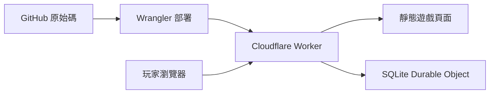

# 移動人生

一款繁體中文職場黑色幽默遊戲。九種應徵職業、雙心情、隨機人設、升遷與離場，收集 288 種職業結局與 38 枚圖文成就。

**[開始遊戲／史冊補完計畫](https://hedo-life.bvstudio.workers.dev)** · **[GitHub Issues](https://github.com/gn02335338/hedo-life/issues)**

## 這次的人生

- 新局的「受不了了，扁他」放在最後一個劇情選項下方，直接針對眼前說話的人。按下才揭曉是腦內幻想，還是真的失控；報到、PIP、降薪與尾牙各有反應。幻想結束回原場景，真動手則進入獨立後續，可走法律處理、和解、打輸、荒謬接班、迷因爆紅或自行離場等分支。每工作回合只結算一次，已確定的結局不能反悔。
- 38 枚成就各有原創插畫、名稱、故事與取得日期，涵蓋職稱落差、職涯、PIP、紓壓、暴走與尾牙。未解鎖的名稱、圖案與條件保密；成就先留在本機，再由伺服器重播驗證後同步，不必等到離場。
- 尾牙在任職中後段隨機登場，依序進場、抽獎、散場。可猜 Rick 的紅白穿搭、搶唱 First Love、聽飯桌上的 NASDAQ、敲空餐盤、抽獎請飲料，再決定如何結束這個晚上。阿良的暗黑續攤邀約必定答應、必定消失；沒有出發就不會扣這筆錢。

- 「史冊補完計畫」可在遊戲網頁填寫，不用 GitHub 帳號。可補故事、提建議或回報問題；預覽並確認公開後，由背景流程代開 Issue。私人佇列只暫存原文，成功後刪除站內副本；公開內容留在 GitHub，投稿不會自動加入遊戲。

- 系統工程師、AI 工程師、MIS 工程師、專案經理、產品經理、設計師、商務開發、業務、空降主管。
- 五階職涯：專業員工 → 副理 → 經理 → 總監 → C-level／副總。九種職業各有職稱路線與每階結局；助理先轉正，空降主管從經理級開始，也能選擇卸任。專案經理、產品經理等專業職稱不等於管理職級。
- 工作、偷懶、舔功由骰子決定；學歷、系所與錄取薪資也會抽取。報到後才知道實際工作，主管則保留原職迎接自己的挑戰。
- 老闆心情與自己的心情會帶來突發轉折。可能升職、被砍薪、進入 Hope 的 PIP，也可能與 Erich、JenJen、Sonny 在離場會議碰面。
- 前期可能被 Wing 笑著問學歷，接著拿校名、科系與薪水找碴。工程職科系落差、他不喜歡的背景，以及相對於實際職務偏高的薪水會加重風險；可能由 Hope 要求提前降薪，或由三件套接手離場。仍可協商、拒絕或要求 PIP，同一段學歷爭議只觸發一次。
- 209 個日常事件、4 個幻想事件，包含 20 個 Rick 技術資深經理的改編橋段與 4 個顧問支線；不用走到最後一關就可能離場。
- 學歷爭議會依 Wing 當下嫌的是科系還是校名，給出對應選項。本科不符時可以報考台大電機、寫信詢問林澤教授是否指導；送出申請不代表已錄取。顧問事件另有辦公室 Wi-Fi、教授介紹與留任、研究問題變上線日期，以及進修也被追進度等原創橋段。
- 扁人的結果揭曉後，腦內夢境會出現淡紫雲霧、月亮與「現實沒有動手」標示，可按「回到現實」繼續。真失控則標示事情真的發生了。背鍋紀錄也會區分；選前不提示會抽到哪一種，舊局的夢境顯示也會潤飾，但不改寫重播資料。
- 未解鎖圖鑑只有問號。選項不顯示數值效果、機率或預告結果；選完會揭曉實際增減、運氣結果與明細，背鍋紀錄也會保留。
- 每個日常、幻想、人事與職涯場景都有至少一個腦洞選項：替報告貼輪迴靈符、請影印機進 PIP、為薪資單辦回顧展。選後回應也跟著改寫；荒謬的做法仍受原本的能力、資源與隨機規則影響。
- 上班會消耗心情；PIP、疲勞與降薪會加重壓力。每個工作回合可花存款紓壓一次，在預算與心情間取捨。PIP 不會自動補高老闆心情。
- 技術經理阿良（Kind）可能在上班途中突然過來揪團，按紓壓也可能遇到他的私房邀約。跟去要花一大筆存款，換回心情與偷懶能力；嫌髒可以拒絕，突然被揪時拒絕就直接回工作，仍可另外安排休息。這條支線採原創虛構設定。
- 離職人物介紹再改編 44 個原創事件：接手前人的工作、挽留與反悔、臨時兼職、薪資單位、交接文件、職務合併與前同事互助。角色採匿名合成設定，私人人物介紹及原始材料不公開。
- 升遷會調整薪資，也會增加日常責任與管理抉擇。新局要先累積目前職級的實際工作經歷，高階評核更挑剔；PIP 通過後有一段工作緩衝期；同一段老闆低潮不會反覆啟動同一套人事流程，回到正常工作、關係恢復後才可能有新的衝突。可以用成果或討好爭取、先補強能力，或婉拒升遷；不必靠帶人才能有自己的好結局。職級路線與觀測站分布不公開未解鎖結局的名稱。
- 圖片史冊擴充加入 30 個原創事件，包括群組留言抽籤與 PIP 期間的續命蘑菇；影音史冊再加入 10 個同事活動與職場反應事件。原始截圖、影片和音軌留在私人研究資料夾。
- 文案依 Humanizer-zh 審讀，保留技術梗和職場黑色幽默，修整不通順或重複的句子。新版事件與文字從新局啟用，舊局維持原本的重播結果。
- 工作證新增「準備升遷」：想訓練或談下一階時可以主動開啟。未達申請條件時不再定期強制叫去評核；婉拒後會多留幾天工作。升遷仍受原本的任期、能力和高階評核限制。
- 手機每次繼續會直接到新故事，故事上方可看心情、體力、存款和 PIP 倒數，再一鍵往返完整工作證。
- 遊戲內可開啟「數值與運氣怎麼算」，查看九項數值與隨機機制的用途。
- Wing、Spencer、Rick、Hope、Erich、JenJen、Sonny、阿良（Kind）各有原創動畫角色；三件套同場時並列三人頭像。另有粉紅白色介面、手機版、可切換音效與可下載的離場證明。

遊戲為非官方的虛構諷刺創作。角色台詞、薪資、機率、人事流程與學歷偏見均為遊戲敘事，不代表已查證事實或對學校／科系的評價。學校與系所是遊戲隨機組合，不是招生資料。公開新聞和產品只作場景靈感；私人 Notion 原文、連結與研究摘錄不包含在公開版本中。

## 匿名收藏與人生觀測站

不必註冊。瀏覽器產生隨機匿名憑證，伺服器保存其雜湊與玩家 ID。已完成遊戲由伺服器重播驗證，同一局重送不會重複計數。斷線時仍可玩，待同步紀錄會自動重試。

觀測站顯示匿名玩家數、完成人生數、結局覆蓋數、平均任職回合、職業分布及每日完成趨勢。匿名玩家數不等於真實人數；統計是休閒用途，不是競賽排名。每日統計使用 UTC。成就保存於同一匿名身分，只記成就 ID 與首次解鎖時間；進行中的成就同步不增加完成人生數。

進度存在目前瀏覽器；清除瀏覽器資料會失去匿名身分。不同裝置是不同玩家。頁尾「匿名紀錄」可匯出／匯入圖鑑，帶走已收藏故事；備份不包含登入憑證，匯入收藏不會增加全站統計。舊版 v1/v2 同網址的收藏會保留，進行中的 v1/v2 舊局因規則不同不會轉換。v3 的既有局則沿用原規則，新增心情消耗、紓壓與擴充事件從新局開始。

遊戲紀錄不要求姓名、Email 或真實學歷，不保存原始 IP、選擇內容或亂數種子。驗證成就時會暫時重播操作紀錄，資料表只另存種子雜湊來綁定人生編號，不留原文。匯出的圖鑑含本機成就、不含匿名憑證；匯入只算本機收藏，不會變成伺服器已驗證紀錄。主動投稿另存私人佇列，防濫用使用短期連線雜湊；公開 Issue 不附匿名玩家 ID。詳細欄位、保留期限與限制見 [Worker 說明](worker/README.md)。

## 本機開發

需要 Node.js 22 與 npm。

```sh
npm ci
npm start
```

開啟 `http://127.0.0.1:4173`。本機使用獨立的 Workers／SQLite 儲存，不會修改正式資料。前端位於 `dist/`，無額外編譯流程；字型載入失敗時使用系統字型。

```sh
npm test
npm run build:check
```

測試涵蓋五階升遷、助理轉正、空降與卸任、分級壓力、故事支線、隨機人設、職務改派、PIP／離場、心情消耗、紓壓與消費限制、結果明細、升遷、薪資、新舊規則重播、288 條自然結局路線、API 驗證與離線重試。`research/reachability-v3.json` 是可重播路線證據，包含劇透；一般遊玩不需要閱讀。重新搜尋全部路線可執行 `node tests/find-routes-v3.mjs 5000`。

e9 平衡調整另跑 72,000 局前後對照與 18,000 局熟手策略，涵蓋九種職業的升遷、降薪、PIP 與離場分布。[實測方法、數據與重跑指令](research/balance-v9.md)。這是模擬情境，不是實際玩家比例。

e10 另完成桌面／手機介面試玩、5,400 局節奏情境檢查，以及新舊重播驗證。[修正內容與驗證範圍](research/playtest-v10.md)。手機採瀏覽器尺寸模擬，情境數據不等於實際玩家比例。

e11 加入前期學歷與薪資爭議，完成 2,700 局自然情境檢查；106 項測試、234 條新版結局路線及全部既有 e10 路線重播通過。[事件規則與驗證](research/education-v11.md)。

e12 為 205 個日常、4 個幻想與 25 個人事／職涯選單逐一改寫腦洞選項，共 234 個場景。111 項測試與全部結局路線通過，舊局保留原文與原重播結果。[文案範圍與驗證](research/wild-v12.md)。

e13 加入隨時開啟的卡通暴走、三段尾牙與 32 枚圖文成就。新機制由新局啟用，e12 與更早存檔保留原結果；已有的可重播遊戲也能補領符合條件的成就。測試涵蓋舊版 234 條路線的 10,172 個檢查點，以及新版全部 234 種結局。新功能 API 可用 `API_BASE=http://127.0.0.1:4177 node scripts/v13-smoke.mjs` 驗證，只允許本機測試資料。[機制與實測紀錄](research/features-v13.md)。

e14 把暴走改為直接針對當下說話的人，按鈕接在最後一個劇情選項下面。幻想與真失控由種子、情緒及對象判定，選後才揭曉；真失控另有六類、54 個職業結局與六枚新成就。既有 e13 存檔仍沿用原流程。181 項測試及全部 288 條新路線通過；另保留 e13 的 243 條結局／功能路線、10,649 個直接與存檔檢查點。新 API 可用 `API_BASE=http://127.0.0.1:4177 node scripts/v14-smoke.mjs` 在本機驗證。[機制與實測紀錄](research/features-v14.md)。

e15 修正科系與校名抱怨的選項對應、加入四個林澤顧問支線，並重寫八位角色的夢境文案與結果介面。191 項測試及全部 288 條新版結局路線通過；292 條 e14 結局／功能路線的 10,931 個檢查點，也逐一比對直接與 JSON 存檔重播。教育選項與新事件從新局啟用；舊局保留原選擇，夢境外觀及顯示用潤飾可直接套用。[機制與實測紀錄](research/features-v15.md)。

真實本機 API smoke 的啟動指令見 [Worker 說明](worker/README.md#local-verification)。Smoke 只允許 localhost，避免測試資料污染正式統計。

## GitHub + Cloudflare

GitHub 保存公開程式、版本與 Issues。Cloudflare Workers 同時提供靜態頁面與 `/api/*`；SQLite Durable Object 保存匿名收藏及統計，不需另設 D1、KV 或外部資料庫。



以自己的 Cloudflare 帳號登入後部署：

```sh
npx wrangler login
npm run deploy
```

本 repo 已啟用 GitHub Actions 自動部署：推送到 `main` 後，會先安裝鎖定依賴、通過測試，再部署到正式站；測試失敗就不會部署。PR 執行檢查但不部署，其他分支也不會部署。也可在 Actions → Deploy to Cloudflare 選擇 `main` 手動重跑。每次成功部署摘要會附上正式網址、commit 與執行紀錄。

部署憑證放在 GitHub 的 `CLOUDFLARE_API_TOKEN` secret，只授權 `hedo-life` 的 Individual Workers Editor；帳號 ID 使用 `CLOUDFLARE_ACCOUNT_ID` secret。要暫停自動更新可將 repo variable `CLOUDFLARE_DEPLOY_ENABLED` 設為 `false`，現有正式站不受影響。Token 無自動到期日；需要停用時可在 Cloudflare 撤銷專用 token。請勿把憑證寫進程式碼。

Fork 到自己的 repo 時，請自行設定上述兩個 secrets、啟用 `CLOUDFLARE_DEPLOY_ENABLED=true`，並修改 Worker 名稱與正式網址。

## 參與史冊補完

遊戲內的「史冊補完計畫」提供三種站內表單：補一頁史冊、遊戲建議、問題回報。玩家不必有 GitHub 帳號；預覽並確認公開後，背景流程會代開 Issue，也保留自行到 GitHub 投稿的入口。請使用化名與自己的摘要，不要貼私人聯絡資料或內部原始文件；素材會先整理，再決定是否改編。

## 參考與素材

玩法節奏參考 [別人的人生](https://otherlife.icareu.tw/) 與 [1 in 8 billion](https://1in8b.life/zh/)，介面色彩、幾何形狀與產品場景參考 [AviviD 官方網站](https://www.avividai.com/)。未複製參考遊戲的程式或故事。Wing 與 Spencer 採誇張五官、不同臉型與身形的原創漫畫角色，遊戲動效由 CSS 製作。
