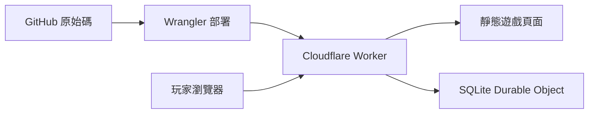

# 移動人生

一款繁體中文職場黑色幽默遊戲。十三種應徵職業、雙心情、隨機人設、升遷與離場，收集 545 種職業結局與 122 枚圖文成就。

**[開始遊戲／史冊補完計畫](https://hedo-life.bvstudio.workers.dev)** · **[GitHub Issues](https://github.com/gn02335338/hedo-life/issues)**

## 這次的人生

- 「受不了了，扁他」放在最後一個劇情選項下方。單人對話直接針對眼前的人；多人明確同場時，先從在場者的頭像與別稱中選一位，也可以取消，例如三件套共同談話可選法師、真真或阿福。挑人不推進時間、不抽結果；確認後才揭曉是腦內幻想，還是真的失控。報到、PIP、降薪與尾牙各有反應。幻想結束回原場景，真動手則進入獨立後續。每工作回合只結算一次，已確定的結局不能反悔。
- 122 枚成就附有原創插畫、名稱、故事與取得日期，涵蓋各職業、八階職涯、學歷、PIP、降薪、花錢自救、能力取捨、暴走與尾牙。未解鎖的名稱、圖案與條件保密；成就先留在本機，再由伺服器重播驗證後同步，不必等到離場。舊局也能依已發生的紀錄補領符合條件的新成就。
- 扁人成就依同一次事件的結果區分「腦內夢境」與「現實出手」。對某人真的動手、報到就真的扁翅膀，以及出手後正式存證，都必須有對應的現實紀錄；夢裡扁人、宣洩與追不到阿良另有自己的章。以前混算的 14 種舊章只保留已收藏的紀念，不計新版進度，也不直接換發實打成就。仍在瀏覽器裡的有效遊戲紀錄若能證明新條件，會另外補領；只有舊章和日期則不推測當年發生的是哪一種。
- 人物圖鑑收錄十六位角色，分開顯示當局互動、已驗證的個人累計與全站合計。想像扁人、真的出手，以及好感增加／減少各自計數；結果揭曉後才更新，不把腦內劇場算成現實。當局好感從 50 起算、介於 0～100，僅用來記錄角色互動，不改變遊戲判定或升遷機率。
- 尾牙在任職中後段隨機登場，依序進場、抽獎、散場。可猜老闆乾兒子的紅白穿搭、替傑克與水蛇的 First Love 搶麥決鬥記分、聽飯桌上的 NASDAQ、敲空餐盤、抽獎請飲料，再決定如何結束這個晚上。阿良的暗黑續攤邀約必定答應、必定消失；沒有出發就不會扣這筆錢。
- 腕力賽保留阿福反覆找理由的橋段：喊抽筋、拉到、吃太飽，卻吃了三片披薩；傑克讓到只比十秒、未分勝負算阿福贏且不錄影，他才上桌。玩家可以計時記錄、替他開披薩盒記者會，或頒發「尚未出賽世界冠軍」。賽後改口與怪別人弄傷手的對白為遊戲創作。這兩場的顯示文案也會套用到舊局與背鍋紀錄，不改原存檔、抽籤、數值或重播結果。

- 「史冊補完計畫」可在遊戲網頁填寫，不用 GitHub 帳號。可補故事、提建議或回報問題；預覽並確認公開後，由背景流程代開 Issue。私人佇列只暫存原文，成功後刪除站內副本；公開內容留在 GitHub，投稿不會自動加入遊戲。

- 可直接選擇系統工程師、AI 工程師、MIS 工程師、專案經理、產品經理、設計師、商務開發、業務、財務專員、會計專員、人資專員或行政專員；另有「隨機職業」，抽選範圍包含以上十二職業與隱藏的高階主管。履歷會揭曉抽中的職業，重擲時職業也會重抽，仍共用三次重擲額度。
- 八階職涯：助理 → 專業員工 → 資深 → 主任 → 副理 → 經理 → 總監 → C-level。系統工程職涯依序是助理工程師、工程師、資深工程師、主任工程師、工程副理、工程經理、工程總監、技術長；其他職業各有對應的完整路線。資深、主任仍是專業職，從副理起才進入管理職；專案經理、產品經理的職稱也不代表已經帶人。一般正式職從專業員工開始，助理先轉正，高階主管從經理級開始，也能選擇卸任。
- 報到分成三種開場：照原職錄取、改派其他職務、改以助理任用。原職開場直接從領名片、聽交辦開始，不預設新人已經擔心被改派；另外兩種會說清楚實際職稱，助理也會核對縮水後的薪資。三種情況各有自己的接受、交涉與離開選項，選後回應也分開寫。
- 工作、偷懶、舔功先骰點數，再分配有限的時間與精力；三項總和最多 180。一次選擇若練高其中一項，另外兩項就得退讓，花錢上課也不例外。實際取捨會列在選後明細。學歷、系所與錄取薪資也會抽取；報到後才知道實際工作，高階主管則保留原職迎接自己的挑戰。
- 存下離場的底氣：新人生完成六個工作回合、存款達 75 後，可以規劃離職創業；完成十個工作回合、存款達 90 後，可以退休或只接自己想做的顧問工作。各自達標後會在安全的工作空檔提醒一次，也能從「我想離職了」或職涯離場清單再查看。規劃與返回不花工作回合、不推進 PIP，也不等於已經離職；創業投入 35 或 40 存款，確認後才扣款並揭曉這輪結果。十三職業各有四種創業／退休結局，共 52 種，未解鎖前照樣保密。
- 「翅膀心情」只代表他本人，影響人事、協商與升遷。同事間的衝突主要記在情義與故事後續；對方真的轉達翅膀的反應，才會有限度地改變這一格。腦內扁人不會讓他隔空生氣，對其他角色真動手，這一格也只承受較小的後續影響。每天另外抽取他的脾氣，與你眼前正在跟誰說話分開計算。
- 前期可能被翅膀笑著問學歷，接著拿校名、科系與薪水找碴。工程職科系落差、他不喜歡的背景，以及相對於實際職務偏高的薪水會加重風險；可能由希望要求提前降薪，或由三件套接手離場。仍可協商、拒絕或要求 PIP，同一段學歷爭議只觸發一次。
- 月薪確實被降到 30K 以下後，法師會在適合談話時私下提醒留存薪資與工時紀錄，並提到諮詢、申訴、調解及訴訟。每局提醒一次，收到提案但還沒接受不算；三種回應包含讓計算機穿法袍出庭，選完回到原工作，不多耗一天或 PIP 倒數。2026 年全時正常工時的最低月薪為 29,500 元，故事不保證個案或訴訟結果。
- 450 個日常事件、4 個幻想事件，包含技術資深經理「老闆乾兒子」、林澤教授、傑克與業務經理水蛇的改編橋段；不用走到最後一關就可能離場。
- 私人同事大問答的 149 題已逐題對照，新增 95 場事件、285 種回應，分散在工作、學歷、調薪、PIP、帳務、聚餐與交接場合。已有橋段延續原場景，相近題材合併，敏感內容則改成匿名職場情境；不公開原始題庫。十五場新增多人談話可以選擇當下的出手對象，提到往事或電話那端的人不會因此出現在房間裡。
- 新增 60 個職業專屬工作事件：業務、商務開發、設計師各 12 個，其餘六職業各 4 個。業務要面對報價、試用、CRM 與獎金；商務開發處理合作條件、通路和漂亮但尚未落地的提案；設計師則要救版位、追原稿、讀懂老闆每天不同的 OK。每個新事件都有腦洞選項，保留史冊裡的設計迴圈、工具預算、功勞歸屬與老闆乾兒子等梗。
- 財務、會計、人資、行政各有八場專屬工作事件，共 32 場、96 種回應，每場至少一個腦洞選項。財務算資金與付款，會計核憑證與月結；行政可能兼招募，人資可能兼行政或被叫去泡咖啡。兼任事件保留主要職稱，報到改派則會交代實際職務。四職業各有完整八階職涯與 42 種結局，原有圖鑑順序保留，合計 545 張。
- 新人生會更常抽到目前實際職業的工作，第一個一般工作事件先從該職業專屬故事開始，也避免連著多天只遇到共通工作。若報到時被改派，工作內容跟著實際職業走；人事、PIP、升遷、尾牙與其他插曲仍保留原本節奏。選前不顯示抽籤機率或結果。
- 學歷爭議會依翅膀當下嫌的是科系還是校名，給出對應選項。本科不符時可以報考台大電機、寫信詢問林澤教授是否指導；送出申請不代表已錄取。顧問事件另有辦公室 Wi-Fi、教授介紹與留任、研究問題變上線日期，以及進修也被追進度等原創橋段。
- 研發部經理傑克帶來六個原創事件：會議筆記、交接轉手、API 帳單、替同事說明困難、PIP 自評，以及離場文件與職稱。玩家以同事身分參與故事；傑克也有動畫頭像與專屬暴走成就。
- 業務經理水蛇加入上班對話，也可能在三樓碰見你。角色採別稱與完全原創動畫肖像，另有專屬暴走故事及兩枚成就；新對話從新版人生啟用。
- 扁人的結果揭曉後，腦內夢境會出現淡紫雲霧、月亮與「現實沒有動手」標示，可按「回到現實」繼續。真失控則標示事情真的發生了。背鍋紀錄也會區分；選前不提示會抽到哪一種，舊局的夢境顯示也會潤飾，但不改寫重播資料。
- 未解鎖圖鑑只有問號。選項不顯示數值效果、機率或預告結果；付費安排會先標明花費，選完才揭曉實際增減、運氣結果與明細，背鍋紀錄也會保留。
- 離場結算改用視覺化報表：能力雷達與長條對照起點、離場，折線呈現心情、體力和存款指數的變化，另列翅膀心情、同事情義與大餅信仰。每個轉折代表一次已結算選擇，同一天的休息、人事與飯局不會被當成額外工作日。缺少紀錄的起點標為未知；報表只讀既有數值，舊結局也能顯示，不改寫存檔或額外上傳資料。
- 每個日常、幻想、人事與職涯場景都有至少一個腦洞選項：替報告貼輪迴靈符、請影印機進 PIP、為薪資單辦回顧展。選後回應也跟著改寫；荒謬的做法仍受原本的能力、資源與隨機規則影響。
- 心情與體力的起伏更明顯：一般劇情的消耗與恢復放大，每天也可能特別耗人或意外順風。PIP、疲勞與降薪會加重壓力；PIP 不會自動補高翅膀心情。尚未確定離場時，心情歸零會在已選結果之後進入真正的當場崩潰，以深紅框與現實標示區別腦內夢境。可以花錢離開現場休整、請無薪假承擔後續月薪減少，或當場念完離職信；沒有強迫角色真的動手。
- 新人生的心情歸零分四階，每階有自己的對白。第二次起，休整越貴、恢復越少，無薪假的薪資與人際代價也會加重；第五次起沿用第四階。畫面只標已經歷的次數與本次費用，選後才揭曉變化。歸零時，最後一個按鈕改成「受不了了，自爆」，可以把壓著的話公開說出來，再選休整、請假或離場。這條是職場情緒失控，不計為真的或夢裡扁人。
- 工作證的「存款怎麼花」每個工作回合可開一次。七種付費安排包括飲料散步、補眠、實作課、備份證據、人脈聚餐、週末休整，以及請玩具鵝擔任主管的練團室會議，分別照顧心情、體力、能力、紀錄或人脈。買不起的選項不會出現，也能選擇先不花。消費不額外推進工作日或 PIP，存款耗盡仍會離場，記得留生活費。
- 找人吃飯可從十六位角色中挑一位，每人有不同的餐桌對話、回應與費用，並保留腦洞選項。名單分兩頁，選人、翻頁或取消不花錢；正式用餐才扣款並結算心情、能力與好感。飯局不多耗工作日或 PIP，低心情的吃飯邀約也使用同一份名單。餐費先列明，付不起仍看得到停用選項；與翅膀吃飯未必能放鬆，阿良的續攤則可能又只剩承諾。
- 技術經理阿良可能在上班途中突然過來揪團，按紓壓也可能遇到他的私房邀約。跟去要花一大筆存款，換回心情與偷懶能力；嫌髒可以拒絕，突然被揪時拒絕就直接回工作，仍可另外安排休息。這條支線採原創虛構設定。
- 離職人物介紹再改編 44 個原創事件：接手前人的工作、挽留與反悔、臨時兼職、薪資單位、交接文件、職務合併與前同事互助。角色採匿名合成設定，私人人物介紹及原始材料不公開。
- 升遷會調整薪資，也會增加日常責任與管理抉擇。新局要先累積目前職級的實際工作經歷，高階評核更挑剔。可以用成果或討好爭取、先補強能力，或婉拒升遷；不必靠帶人才能有自己的好結局。職級路線與觀測站分布不公開未解鎖結局的名稱。
- PIP 通過不代表人事衝突解除：選擇留下後，可能被安排到三樓看門，辦公室與原本的工作仍在五樓。值班期間有獨立日常與後續選擇，保留收入也要承受沒有工作可做的壓力。通過後若再因新的對話惹怒翅膀，他的耐心會比先前低；持續低心情本身不會每回合重複觸發處分。
- 翅膀大怒時也可能不給 PIP，直接由三件套通知離場。這條流程不再藏著一個「要求 PIP 就能留下」的選項；可以核對文件離場，或整理紀錄向勞工局反映、進入遊戲中的勞資調解。故事不保證申訴或協商結果。
- 圖片史冊擴充加入 30 個原創事件，包括群組留言抽籤與 PIP 期間的續命蘑菇；影音史冊再加入 10 個同事活動與職場反應事件。原始截圖、影片和音軌留在私人研究資料夾。
- 文案依 Humanizer-zh 審讀，保留技術梗和職場黑色幽默，修整不通順或重複的句子。新版事件與文字從新局啟用，舊局維持原本的重播結果。
- 工作證新增「準備升遷」：想訓練或談下一階時可以主動開啟。未達申請條件時不再定期強制叫去評核；婉拒後會多留幾天工作。升遷仍受原本的任期、能力和高階評核限制。
- 新局另有「我要談加薪」，與升遷分開。完成三個工作回合後，可以帶成果談薪、先整理翅膀的方向，或拿玉璽印泥墊請他御批；結果可能是書面方案、口頭拖延，或把薪資問題談成忠誠度考試。真正接受書面條件才會改月薪，職級不會跟著升；若方案拿其他給付抵銷，還能看清楚後拒絕。正式談過後須再工作五回合，每局最多三次，收回資料、不正式開口則不占次數。談話本身不多算工作日、任期或 PIP 倒數。
- 手機每次繼續會直接到新故事，故事上方可看心情、體力、存款和 PIP 倒數，再一鍵往返完整工作證。
- 體力或心情剩 30 以下時，故事與結果頁會顯示預警；15 以下改為紅色危急提醒。可休息時能直接查看休息安排，暫時無法休息時會說明原因。提醒只讀目前數值，不預測選項結果，也不改變遊戲判定。
- 工作證的消費、升遷與加薪入口，停用時會直接寫出原因，手機也不必靠滑鼠提示。查看事件結果、報到與人事通知期間，先完成眼前流程；回到工作後再依任期、PIP 與等待時間判斷是否開放。休息每個工作回合只能開啟一次，選「先不花錢」也算使用這次安排，選單會先提醒。
- 遊戲內可開啟「數值與運氣怎麼算」，查看九項數值與隨機機制的用途。
- 翅膀、屎潘蛇、老闆乾兒子、希望、法師、真真、阿福、阿良、傑克、水蛇與海倫（前女友）各有原創動畫角色；三件套同場時並列三人頭像。另有粉紅白色介面、手機版、可切換音效與可下載的離場證明。

新增 20 個史冊改編事件：端午猜謎靈感 8 個、阿福日常 6 個、海倫故事 6 個。阿福也叫桑尼；海倫以「前女友」別稱加入，職位為產品開發總監，故事涵蓋開門、SQL、交接延期、離場後的需求與群組權限。綽號採辦公室比喻，不當作真實交往紀錄。角色有原創動畫頭像、專屬夢境／現實失控反應，互動與好感可在角色圖鑑查看。新內容由 `e22-` 新人生啟用，現有存檔保留原結果與亂數序列。

選職頁新增「翅膀欽點・徵才標語」：要好命就不要來移動，要計較就趁早離開這裡。報到桌前的「報到須知」會再呼應一次。標語只更新畫面，不提前透露選項結果，也不影響心情、亂數或工作安排。

五位同事加入角色圖鑑，每人有原創動畫頭像、四段日常與自己的夢境／實際失控反應：稽核主管紅茶、助理工程師強哥、商務開發總監歐文、資深資料探勘工程師山姆、資深專案管理師辛蒂。故事包括刪不掉的印表機、助理工程師的責任邊界、重複跟進與離職倒數、洋芋片讀書會與沒約成的離職飯，以及主管接力與反覆變動的老闆評語。每段保留腦洞選項；紅茶與阿福的關係、辛蒂與主管離場的關聯都保留為辦公室傳聞，不替角色確認原因。新事件由 `e23-` 新人生啟用，舊局沿用原本的故事與亂數。

行政長改以「真真」顯示，角色 ID、頭像、成就與統計沿用；舊對話及背鍋紀錄也會顯示新名字。引擎使用的歷史文字另行保留，不改寫已儲存的人生或重播證據。

角色統一使用別稱；顧問角色以「林澤教授」稱呼。舊局的工作證、對白、背鍋紀錄、圖鑑與離場證明也會顯示新名稱，但不改寫原始存檔或重播資料。

薪資標籤統一為「月薪」，舊紀錄也套用目前顯示用語；原始重播文字維持不變。

目前仍使用預設遊戲選項，尚未串接 Gemini 或開放自填答案；Gemini 串接僅評估可行性，未啟用。史冊投稿表單與遊戲答案分開處理。

遊戲為非官方的虛構諷刺創作。角色台詞、薪資、機率、人事流程與學歷偏見均為遊戲敘事，不代表已查證事實或對學校／科系的評價。學校與系所是遊戲隨機組合，不是招生資料。公開新聞和產品只作場景靈感；私人 Notion 原文、連結與研究摘錄不包含在公開版本中。

## 準備升遷的條件

八階職涯使用以下規則，職稱依實際職業對應。工作證從 DAY 4 起，可在一般工作事件開啟「準備升遷」；當下不能正在 PIP、查看結果或處理其他通知，職級也必須還能往上。開得了選單，只代表可以準備或訓練，申請還要符合任期、當前數值與評核間隔。

下表中的「任期」只計目前職級完成的日常／幻想工作回合；升遷、助理轉正或卸任後重新累積。評核、訓練、談薪、休息及主管抉擇不增加任期。數值都是最低值，兩條路擇一，且體力必須大於 10、自己的心情大於 12。

| 這次要談的職級 | 最早遊戲日 | 目前職級工作任期 | 實績路線 | 討好路線 |
| --- | --- | --- | --- | --- |
| 助理 → 專業員工 | DAY 4 | 2 回合 | 工作 50、情義 30、翅膀心情 35 | 舔功 55、翅膀心情 55 |
| 專業員工 → 資深 | DAY 5 | 2 回合 | 工作 55、情義 35、翅膀心情 40 | 舔功 60、翅膀心情 60 |
| 資深 → 主任 | DAY 8 | 3 回合 | 工作 62、情義 40、翅膀心情 43 | 舔功 66、翅膀心情 64 |
| 主任 → 副理 | DAY 11 | 3 回合 | 工作 68、情義 45、翅膀心情 48 | 舔功 72、翅膀心情 70 |
| 副理 → 經理 | DAY 14 | 3 回合 | 工作 75、情義 50、翅膀心情 55 | 舔功 80、翅膀心情 78、工作 58、情義 35 |
| 經理 → 總監 | DAY 17 | 3 回合 | 工作 83、情義 60、翅膀心情 63 | 舔功 87、翅膀心情 85、工作 70、情義 45 |
| 總監 → C-level | DAY 21 | 4 回合 | 工作 90、情義 70、翅膀心情 72 | 舔功 94、翅膀心情 92、工作 80、情義 55 |

助理到主任在上次評核後至少隔兩個工作日，副理以上至少隔三個；選擇「這次先不升」則延後六個工作日。訓練和失敗也算一次評核，不能靠反覆開關選單重骰。條件齊了仍要通過隨機評核，越高階越挑剔；沒有任何一條路保證成功。自動邀請也會等到至少有一條申請路線可用才出現。

## 匿名收藏與人生觀測站

不必註冊。瀏覽器產生隨機匿名憑證，伺服器保存其雜湊與玩家 ID。已完成遊戲由伺服器重播驗證，同一局重送不會重複計數。斷線時仍可玩，待同步紀錄會自動重試。

觀測站顯示匿名玩家數、完成人生數、結局覆蓋數、平均任職回合、職業分布及每日完成趨勢。匿名玩家數不等於真實人數；統計是休閒用途，不是競賽排名。每日統計使用 UTC。成就保存於同一匿名身分，只記成就 ID 與首次解鎖時間；進行中的成就同步不增加完成人生數。

人物統計另記完成互動次數、想像／真出手次數，以及實際好感增減量與發生次數。翅膀的好感只採用已揭曉選擇造成的變化，排除每日脾氣與臨場運氣；其他角色依當下互動記錄，不把整個團隊的情義分數當成個人好感。三件套的普通共同談話會分別記一次互動；暴走只記實際選中的那位，其餘兩人不跟著增加被扁次數。這些數字不代表真實人物的感受。

人物統計從功能上線起開始驗證收錄。進行中的同一局以延續原分支的紀錄補上增量，重送不會重複計數；已完成的舊局若沒有當時的角色驗證紀錄，不會猜測回補。原有結局與成就仍保留。離線時的當局預覽與已驗證累計分開顯示，未載入的全站資料不會冒充即時數字。

進度存在目前瀏覽器；清除瀏覽器資料會失去匿名身分。不同裝置是不同玩家。頁尾「匿名紀錄」可匯出／匯入圖鑑，帶走已收藏故事；備份不包含登入憑證，匯入收藏不會增加全站統計。舊版 v1/v2 同網址的收藏會保留，進行中的 v1/v2 舊局因規則不同不會轉換。v3 的既有局則沿用原規則；e21 新局保留八階職涯、能力取捨、心情體力波動、崩潰、消費、獨立談薪與 e20 人事流程，再加入職業專屬工作與新的工作抽選安排。e20 與更早局保留原本的事件池、歷史、亂數序列與重播結果；e19 與更早局不插入 e20 人事事件或水蛇對話，e18 與更早局也不插入談薪。

遊戲紀錄不要求姓名、Email 或真實學歷，不保存原始 IP、選擇內容或亂數種子。驗證時會暫時重播操作紀錄；伺服器保存人生與玩家的綁定、種子及操作序列的雜湊、已驗證操作數與角色累計，不留操作原文或對話。個人角色累計須用本機匿名憑證讀取，全站只公開合計。匯出的圖鑑含本機成就、不含匿名憑證；匯入只算本機收藏，不會變成伺服器已驗證紀錄。主動投稿另存私人佇列，防濫用使用短期連線雜湊；公開 Issue 不附匿名玩家 ID。詳細欄位、保留期限與限制見 [Worker 說明](worker/README.md)。

## 本機開發

需要 Node.js 22 與 npm。

```sh
npm ci
npm start
```

開啟 `http://127.0.0.1:4173`。本機使用獨立的 Workers／SQLite 儲存，不會修改正式資料。前端位於 `dist/`，無額外編譯流程；字型載入失敗時使用系統字型。

```sh
npm test
npm run build:check
```

測試涵蓋八階升遷、助理轉正、高階主管與卸任、專業與管理責任、三種報到選項、故事支線、隨機人設、職務改派、PIP／直接離場、三樓待命、勞資爭議故事、心情消耗、紓壓與消費限制、結果明細、薪資、新舊規則重播、自然結局路線、API 驗證與離線重試。`research/reachability-v3.json` 是可重播路線證據，包含劇透；一般遊玩不需要閱讀。重新搜尋全部 341 種結局的路線可執行 `node tests/find-routes-v3.mjs 5000`。

e9 平衡調整另跑 72,000 局前後對照與 18,000 局熟手策略，涵蓋九種職業的升遷、降薪、PIP 與離場分布。[實測方法、數據與重跑指令](research/balance-v9.md)。這是模擬情境，不是實際玩家比例。

e10 另完成桌面／手機介面試玩、5,400 局節奏情境檢查，以及新舊重播驗證。[修正內容與驗證範圍](research/playtest-v10.md)。手機採瀏覽器尺寸模擬，情境數據不等於實際玩家比例。

e11 加入前期學歷與薪資爭議，完成 2,700 局自然情境檢查；106 項測試、234 條新版結局路線及全部既有 e10 路線重播通過。[事件規則與驗證](research/education-v11.md)。

e12 為 205 個日常、4 個幻想與 25 個人事／職涯選單逐一改寫腦洞選項，共 234 個場景。111 項測試與全部結局路線通過，舊局保留原文與原重播結果。[文案範圍與驗證](research/wild-v12.md)。

e13 加入隨時開啟的卡通暴走、三段尾牙與 32 枚圖文成就。新機制由新局啟用，e12 與更早存檔保留原結果；已有的可重播遊戲也能補領符合條件的成就。測試涵蓋舊版 234 條路線的 10,172 個檢查點，以及新版全部 234 種結局。新功能 API 可用 `API_BASE=http://127.0.0.1:4177 node scripts/v13-smoke.mjs` 驗證，只允許本機測試資料。[機制與實測紀錄](research/features-v13.md)。

e14 把暴走改為直接針對當下說話的人，按鈕接在最後一個劇情選項下面。幻想與真失控由種子、情緒及對象判定，選後才揭曉；真失控另有六類、54 個職業結局與六枚新成就。既有 e13 存檔仍沿用原流程。181 項測試及全部 288 條新路線通過；另保留 e13 的 243 條結局／功能路線、10,649 個直接與存檔檢查點。新 API 可用 `API_BASE=http://127.0.0.1:4177 node scripts/v14-smoke.mjs` 在本機驗證。[機制與實測紀錄](research/features-v14.md)。

e15 修正科系與校名抱怨的選項對應、加入四個顧問支線，並重寫八位角色的夢境文案與結果介面。191 項測試及全部 288 條新版結局路線通過；292 條 e14 結局／功能路線的 10,931 個檢查點，也逐一比對直接與 JSON 存檔重播。教育選項與新事件從新局啟用；舊局保留原選擇，夢境外觀及顯示用潤飾可直接套用。[機制與實測紀錄](research/features-v15.md)。

e16 將應徵職業改稱「高階主管」，統一角色別稱，並加入研發部經理傑克的六個事件、動畫頭像與暴走成就。新局共有 215 個日常事件、4 個幻想事件、288 種結局與 39 枚成就。傑克事件從新局啟用；既有 e15 與更早局的事件池、機率、亂數序列和重播結果維持原樣，別名只更新顯示。

同時補回新局漏套的升遷限制：任期、訓練增益、高階評核與自動邀請沿用 e12 的平衡規則，前期學歷降薪也會使用對應文案。205 項測試、全部 288 條新版結局路線，以及 e15 的 292 條路線、10,470 個直接與 JSON 存檔檢查點通過；另以本機 HTTP 驗證傑克的暴走成就、失控結局、匿名隔離與重送去重。

e17 將新局職涯展開為八階，補上資深與主任的專業工作、評核及離場故事；新增 8 個助理、9 個資深與 9 個主任結局，總計 314 種。原有 288 個結局 ID 保留，仍可從原本的離場路徑取得。日常事件仍為 215 個、幻想事件 4 個、成就 39 枚。報到的三種情況改用不同敘述、選項與結果；角色抽選方式不變，高階主管仍藏在隨機職業裡。

e17 發布時的新局使用 `e17-` 種子。新版的 rank 0–7 依序是助理、專業員工、資深、主任、副理、經理、總監、C-level；高階主管起始為 rank 5。既有 e16 與更早存檔保留五階職涯與原始重播結果，不直接換算成八階。匿名身分、存檔版本及伺服器重播驗證方式不變，資料庫無須遷移。

e18 的新局改用 `e18-` 種子，沿用八階職涯、215 個日常事件、4 個幻想事件與 314 種結局，成就擴充為 112 枚。這次將三項能力改為總和最多 180 的消長規則，放大心情與體力波動，加入歸零後的現實崩潰、七種存款用途，並把翅膀心情與其他人物的反應分開。e17 與更早局不套用這些新數值規則，符合條件的舊紀錄仍可補領新增成就；匿名身分、遊戲版本 3 與資料庫格式不變。

e18 已通過 247 項測試、部署建置與本機 HTTP 驗證。全部 314 種結局都有新版重播證據；[成就路線](tests/fixtures/achievement-routes-v18.json) 以 21 條新版自然操作涵蓋 112 枚成就。e17 的 318 條結局／暴走路線與 13,197 個檢查點也保留比對。另用九職業、相同初始種子各跑定期照顧與不消費兩組，共 900 局：平均工作回合約 20.11 與 9.01，發生崩潰的局數為 68／450 與 290／450；這是測試策略比較，不代表所有玩家的固定機率。

e19 新局使用 `e19-` 種子，加入獨立談薪與書面確認，沿用 112 枚成就、314 種結局及八階職涯。提出方案不會先加薪，接受確認後才更新月薪與日後職級薪資的計算基準；口頭承諾、拒絕或爆氣不會直接加薪。談薪過程可被暴走或心情歸零打斷，恢復後接回原本的對話。角色、台詞與條件採原創虛構設定；沒有加入私人史冊原文或來源連結。匿名身分、遊戲版本 3 與資料表不變，無須遷移資料庫。

e19 已通過 263 項測試與部署建置；[29 條自然談薪路線](tests/fixtures/raise-routes-v19.json) 涵蓋九種職業、口頭承諾、書面調薪、抵銷方案、冷卻與上限，以及暴走、崩潰和人事流程。全部 314 種結局已重新搜尋；e18 的 318 條結局／暴走路線及 14,261 個檢查點保留逐步比對，舊局不改寫。

e20 新局使用 `e20-` 種子，加入通過 PIP 後的三樓看門安排、後續低耐心，以及不提供 PIP 的直接離場與勞資爭議故事。三樓值班照樣計工作日，通知、協商與調解對話則不額外消耗工作回合；選項仍在選後才揭曉結果。業務經理水蛇以原創動畫角色加入，也有兩枚專屬成就。新目錄共有 223 個日常事件、4 個幻想事件、341 種結局與 114 枚成就。

既有 e19 及更早存檔不套用 e20 人事判定、新事件或額外亂數。新版仍使用原有匿名身分、本機儲存鍵、遊戲版本 3 與伺服器重播驗證，資料庫無須遷移；不新增玩家個資或自由文字蒐集。

e21 新局使用 `e21-` 種子，新增 60 個職業專屬工作事件，日常目錄增至 283 個，另保留 4 個幻想事件、341 種結局與 114 枚成就。工作抽選以實際職業為準，第一個一般工作事件為該職業專屬；後續提高專屬與跨職相關工作的出場頻率，也避免連續共通工作沖淡職業特色。每個新增事件都有至少一個腦洞選項，對白、情境與結果皆為原創遊戲改編。e20 及更早局不套用新事件、抽選順序或額外亂數，匿名身分、儲存格式與資料庫維持原樣。

另以業務、商務開發、設計師各三種選擇策略跑 900 局節奏檢查，11,806 個已完成的一般工作事件沒有重複；239 次 PIP 評核前均有三個完整工作回合，未出現 C-level。這是固定策略的模擬結果，不代表實際玩家比例。可用 `node scripts/pacing-audit-v21.mjs 100` 重跑，報表會寫到忽略提交的 `artifacts/player-qa-v21/`。開啟休息、升遷等選單後返回同一件未完成工作，會另外計數，不算工作事件重抽。

e22 使用 `e22-` 新種子，新增 20 段猜謎、阿福與海倫事件，角色增至十一位。所有 341 種結局及 20 段新事件均有自然回放證據；舊 e21 的 341 條路線、14,541 個存檔邊界保持一致。[新增事件、相容方式與原創頭像製作紀錄](research/features-v22.md)。

e23 以 `e23-` 新種子增加五位角色與 20 段事件。36 組自然操作證據涵蓋全部新事件、五人的夢境／實際失控，以及三場多人談話的指定對象；舊 e22 的 341 條路線、14,329 個存檔邊界逐一比對。新增角色沿用既有統計表，不重建匿名身分或累計數據。舊十人／十一人快取仍能讀取，尚未取得的新角色資料以「—」顯示。

e24 以 `e24-` 新種子加入法師的降薪提醒，涵蓋正式接受降薪、無薪假與卸任造成的薪資減少。13 組自然操作證據核對提案、30K 邊界、提醒回應及夢境／實際失控；舊 e23 的 341 條路線、14,474 個存檔邊界保持一致。提醒會等急迫人事、崩潰或其他對話結束再出現；若尚未開口就恢復至 30K 以上，則取消提醒。沿用原有匿名身分與資料表，無須資料庫遷移。

e25 使用 `e25-` 新種子，加入四階崩潰、情緒自爆及十六人飯局。71 組自然操作證據涵蓋四階、自爆後續、全部飯局的兩種用餐回應及低心情入口；舊 e24 的 341 條路線、14,208 個存檔邊界保留逐步比對。開名單不算付費休息，實際用餐才計入相關成就。另修正反覆無薪假降到 20K 以下後，普通降薪提案反而調高薪水的問題；僅新局套用。匿名身分、原有統計、存檔版本與資料庫不變。

e26 使用 `e26-` 新種子，加入同事大問答改編的 95 場事件，日常總數增至 418，另保留 4 個幻想事件、341 種結局與 118 枚成就。[294 條自然路線](tests/fixtures/quiz-routes-v26.json) 涵蓋每個新選項與九種實際職業，每條都附上可完成的後續；十五場多人對話的 33 位合法目標也逐一驗證事件前與結果後的操作。舊 e25 的 341 局、14,114 個完整存檔邊界保持一致，匿名身分、人物累計、成就及資料庫不變。[改編與驗證紀錄](research/features-v26.md)。

e27 使用 `e27-` 新種子，加入存款門檻的離職規劃與 36 種各職業創業／退休結局，總數增至 377。初版保留 418 個日常事件、4 個幻想事件與 118 枚成就。提醒會等人事、PIP、崩潰及其他安排結束，僅在適合的工作空檔出現；退休由玩家確認，創業結果在投入後才揭曉。舊 e26 的 341 局、14,502 個完整存檔邊界保持一致，既有玩家身分、收藏、統計與資料表不變。[規則與驗證紀錄](research/features-v27.md)。

扁人成就另有 [26 條自然操作證據](tests/fixtures/rage-achievement-routes.json)，涵蓋十位角色的真實／夢境、報到時機、存證與失控後續。判定只讀已發生的歷史，不更動存檔、亂數或故事路線；既有 21 條 e18 成就路線也保留原操作，按新條件核對獎章，再以 [四條橋段操作證據](tests/fixtures/chronicle-achievement-routes.json) 核對 First Love 搶麥決鬥的兩種抽籤結果、阿福的理由伯記者會，以及尚未出賽世界冠軍，合計涵蓋原有 118 枚。三枚新章依已結算的選擇解鎖，不看顯示文案或待選選項；未解鎖前，名稱、圖案與條件同樣保密。這兩個橋段不屬於真的動手，不會因此取得扁人成就。

創業／退休另有四枚原創圖文成就，讓總數增至 122：創業成功與失敗分開記錄；玩具鵝董事長依永久休假案解鎖，量產玩具鵝不算；完全退休可取得爽爽退休章，偶爾接顧問案則保留自己的結局。判定只讀已結算的選擇與實際支出，不靠預告、旗標或結局名稱猜測。[自然操作路線](tests/fixtures/wealth-routes-v27.json) 涵蓋兩種創業方式與退休分支，桌機／手機介面及伺服器重播一併核對。未解鎖前，名稱、插畫與條件繼續保密。保留完整 e27 操作紀錄的舊局也能補領，不必重開。

人物統計是獨立的歷史投影，不增加遊戲規則版本或消耗亂數，也不改寫舊局。伺服器另建角色統計表，保存已驗證分支的雜湊與個人／全站計數；原有結局、成就、匿名身分及遊戲存檔格式不變。新增資料表由 Worker 啟動時建立，不需重建既有資料庫。

多人對話的挑人功能適用於 e14 及之後的既有局，不必另開新種子。原本沒有指定對象的操作仍沿用舊預設與重播結果；新操作只能選當時在場的人。取消選人不會留下遊戲操作，也不能藉此重抽結果。已同步的同一人生不能改選另一位來替換原分支。

真實本機 API smoke 的啟動指令見 [Worker 說明](worker/README.md#local-verification)。Smoke 只允許 localhost，避免測試資料污染正式統計。

## GitHub + Cloudflare

GitHub 保存公開程式、版本與 Issues。Cloudflare Workers 同時提供靜態頁面與 `/api/*`；SQLite Durable Object 保存匿名收藏及統計，不需另設 D1、KV 或外部資料庫。



以自己的 Cloudflare 帳號登入後部署：

```sh
npx wrangler login
npm run deploy
```

本 repo 已啟用 GitHub Actions 自動部署：推送到 `main` 後，會先安裝鎖定依賴、通過測試，再部署到正式站；測試失敗就不會部署。PR 執行檢查但不部署，其他分支也不會部署。也可在 Actions → Deploy to Cloudflare 選擇 `main` 手動重跑。每次成功部署摘要會附上正式網址、commit 與執行紀錄。

部署憑證放在 GitHub 的 `CLOUDFLARE_API_TOKEN` secret，只授權 `hedo-life` 的 Individual Workers Editor；帳號 ID 使用 `CLOUDFLARE_ACCOUNT_ID` secret。要暫停自動更新可將 repo variable `CLOUDFLARE_DEPLOY_ENABLED` 設為 `false`，現有正式站不受影響。Token 無自動到期日；需要停用時可在 Cloudflare 撤銷專用 token。請勿把憑證寫進程式碼。

Fork 到自己的 repo 時，請自行設定上述兩個 secrets、啟用 `CLOUDFLARE_DEPLOY_ENABLED=true`，並修改 Worker 名稱與正式網址。

## 參與史冊補完

遊戲內的「史冊補完計畫」提供三種站內表單：補一頁史冊、遊戲建議、問題回報。玩家不必有 GitHub 帳號；預覽並確認公開後，背景流程會代開 Issue，也保留自行到 GitHub 投稿的入口。請使用化名與自己的摘要，不要貼私人聯絡資料或內部原始文件；素材會先整理，再決定是否改編。

## 參考與素材

玩法節奏參考 [別人的人生](https://otherlife.icareu.tw/) 與 [1 in 8 billion](https://1in8b.life/zh/)，介面色彩、幾何形狀與產品場景參考 [AviviD 官方網站](https://www.avividai.com/)。未複製參考遊戲的程式或故事。翅膀與屎潘蛇採誇張五官、不同臉型與身形的原創漫畫角色，遊戲動效由 CSS 製作。

新版 e28 的四種幕僚職業、32 場事件與 168 張追加結局，詳見[規則與驗證紀錄](research/features-v28.md)。舊 e27 的 377 局、16,192 個完整存檔邊界保持一致。
