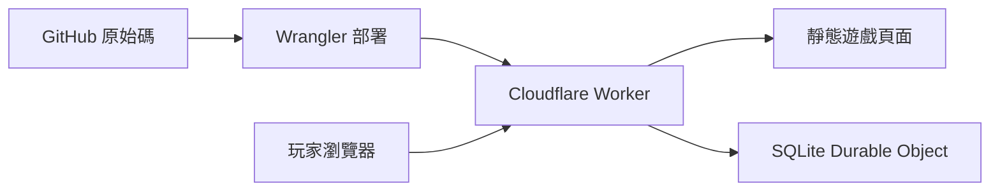

# 移動人生

一款繁體中文職場黑色幽默遊戲。九種應徵職業、雙心情、隨機人設、升遷與離場，收集 144 種職業結局。

**[開始遊戲](https://hedo-life.bvstudio.workers.dev)** · **[史冊補完計畫](https://github.com/gn02335338/hedo-life/issues/new/choose)**

## 這次的人生

- 系統工程師、AI 工程師、MIS 工程師、專案經理、產品經理、設計師、商務開發、業務、空降主管。
- 工作、偷懶、舔功由骰子決定；學歷、系所與錄取薪資也會抽取。報到後才知道實際工作，主管則保留原職迎接自己的挑戰。
- 老闆心情與自己的心情會帶來突發轉折。可能升職、被砍薪、進入 Hope 的 PIP，也可能與 Erich、JenJen、Sonny 在離場會議碰面。
- 157 個日常事件、4 個幻想事件，包含 20 個 Rick 技術資深經理的改編橋段；不用走到最後一關就可能離場。
- 未解鎖圖鑑只有問號。選項不顯示數值效果、機率或預告結果；選完會揭曉實際增減、運氣結果與明細，背鍋紀錄也會保留。
- 上班會消耗心情；PIP、疲勞與降薪會加重壓力。每個工作回合可花存款紓壓一次，在預算與心情間取捨。PIP 不會自動補高老闆心情。
- 紓壓時可能遇到技術經理阿良（Kind）的私房邀約。跟去要花一大筆存款，換回心情與偷懶能力；也能嫌髒拒絕，再選一般休息。這條支線採原創虛構設定。
- 圖片史冊擴充加入 30 個原創事件，包括群組留言抽籤與 PIP 期間的續命蘑菇；影音史冊再加入 10 個同事活動與職場反應事件。原始截圖、影片和音軌留在私人研究資料夾。
- 文案依 Humanizer-zh 審讀，保留技術梗和職場黑色幽默，修整不通順或重複的句子。新版事件與文字從新局啟用，舊局維持原本的重播結果。
- 遊戲內可開啟「數值與運氣怎麼算」，查看九項數值與隨機機制的用途。
- Wing、Spencer、Rick、Hope、Erich、JenJen、Sonny、阿良（Kind）各有原創動畫角色；三件套同場時並列三人頭像。另有粉紅白色介面、手機版、可切換音效與可下載的離場證明。

遊戲為非官方的虛構諷刺創作。角色台詞、薪資、機率、人事流程與學歷偏見均為遊戲敘事，不代表已查證事實或對學校／科系的評價。學校與系所是遊戲隨機組合，不是招生資料。公開新聞和產品只作場景靈感；私人 Notion 原文、連結與研究摘錄不包含在公開版本中。

## 匿名收藏與人生觀測站

不必註冊。瀏覽器產生隨機匿名憑證，伺服器保存其雜湊與玩家 ID。已完成遊戲由伺服器重播驗證，同一局重送不會重複計數。斷線時仍可玩，待同步紀錄會自動重試。

觀測站顯示匿名玩家數、完成人生數、結局覆蓋數、平均任職回合、職業分布及每日完成趨勢。匿名玩家數不等於真實人數；統計是休閒用途，不是競賽排名。每日統計使用 UTC。

進度存在目前瀏覽器；清除瀏覽器資料會失去匿名身分。不同裝置是不同玩家。頁尾「匿名紀錄」可匯出／匯入圖鑑，帶走已收藏故事；備份不包含登入憑證，匯入收藏不會增加全站統計。舊版 v1/v2 同網址的收藏會保留，進行中的 v1/v2 舊局因規則不同不會轉換。v3 的既有局則沿用原規則，新增心情消耗、紓壓與擴充事件從新局開始。

應用資料表不保存姓名、Email、IP、真實學歷、原始選擇或亂數種子。詳細欄位、API 與限制見 [Worker 說明](worker/README.md)。

## 本機開發

需要 Node.js 22 與 npm。

```sh
npm ci
npm start
```

開啟 `http://127.0.0.1:4173`。本機使用獨立的 Workers／SQLite 儲存，不會修改正式資料。前端位於 `dist/`，無額外編譯流程；字型載入失敗時使用系統字型。

```sh
npm test
npm run build:check
```

測試涵蓋隨機人設、職務改派、PIP／離場、心情消耗、紓壓與消費限制、結果明細、升遷、薪資、新舊規則重播、144 條自然結局路線、API 驗證與離線重試。`research/reachability-v3.json` 是可重播路線證據，包含劇透；一般遊玩不需要閱讀。重新搜尋全部路線可執行 `node tests/find-routes-v3.mjs 5000`。

真實本機 API smoke 的啟動指令見 [Worker 說明](worker/README.md#local-verification)。Smoke 只允許 localhost，避免測試資料污染正式統計。

## GitHub + Cloudflare

GitHub 保存公開程式、版本與 Issues。Cloudflare Workers 同時提供靜態頁面與 `/api/*`；SQLite Durable Object 保存匿名收藏及統計，不需另設 D1、KV 或外部資料庫。



以自己的 Cloudflare 帳號登入後部署：

```sh
npx wrangler login
npm run deploy
```

本 repo 已啟用 GitHub Actions 自動部署：推送到 `main` 後，會先安裝鎖定依賴、通過測試，再部署到正式站；測試失敗就不會部署。PR 執行檢查但不部署，其他分支也不會部署。也可在 Actions → Deploy to Cloudflare 選擇 `main` 手動重跑。每次成功部署摘要會附上正式網址、commit 與執行紀錄。

部署憑證放在 GitHub 的 `CLOUDFLARE_API_TOKEN` secret，只授權 `hedo-life` 的 Individual Workers Editor；帳號 ID 使用 `CLOUDFLARE_ACCOUNT_ID` secret。要暫停自動更新可將 repo variable `CLOUDFLARE_DEPLOY_ENABLED` 設為 `false`，現有正式站不受影響。Token 無自動到期日；需要停用時可在 Cloudflare 撤銷專用 token。請勿把憑證寫進程式碼。

Fork 到自己的 repo 時，請自行設定上述兩個 secrets、啟用 `CLOUDFLARE_DEPLOY_ENABLED=true`，並修改 Worker 名稱與正式網址。

## 參與史冊補完

遊戲內的「史冊補完計畫」提供三種 GitHub Issue 表單：補一頁史冊、遊戲建議、問題回報。請使用化名與去識別摘要，不要貼私人聯絡資料或內部原始文件；素材會先整理，再決定是否改編。

## 參考與素材

玩法節奏參考 [別人的人生](https://otherlife.icareu.tw/) 與 [1 in 8 billion](https://1in8b.life/zh/)，介面色彩、幾何形狀與產品場景參考 [AviviD 官方網站](https://www.avividai.com/)。未複製參考遊戲的程式或故事。Wing 與 Spencer 採誇張五官、不同臉型與身形的原創漫畫角色，遊戲動效由 CSS 製作。
